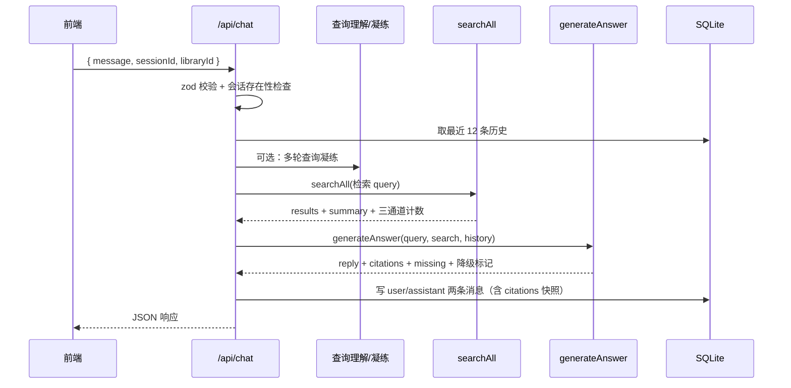
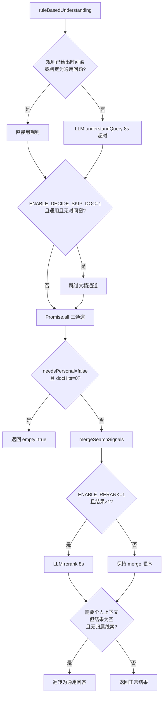
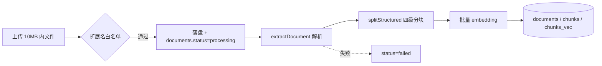
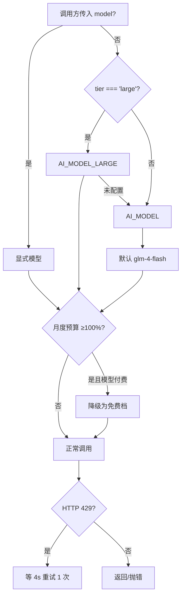
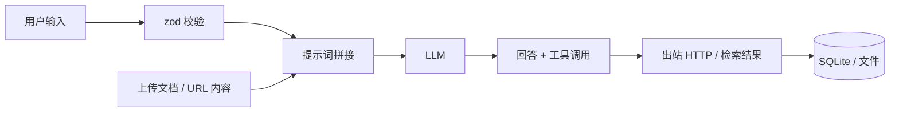

# 知识地图 × 后端实现分册

> 对象：`apps/server`（Express + Drizzle + LangChain）
> 代码快照：2026-11-16
> 对照依据：知识地图六域（编排 / Agentic RAG / 上下文工程 / LLMOps / 模型路由 / AI 安全）
> 配套文档：[前端分册](./ai-knowledge-map-frontend.md)、[AI 能力全景](./ai-capabilities-overview.md)

---

## 0. 结论先行

### 0.1 六域成熟度总览

| #   | 知识域             | 当前形态（一句话）                                                              | 主入口                                                                          | 成熟度                                     |
| --- | ------------------ | ------------------------------------------------------------------------------- | ------------------------------------------------------------------------------- | ------------------------------------------ |
| 1   | 编排 Orchestration | 固定 DAG：三通道并行检索 → 分支生成 → 可选的工具 ReAct 子循环；无状态、无检查点 | `routes/chat.ts`、`search/searchAll.ts`、`answer/generate.ts`、`tools/agent.ts` | 基础可用，缺图/检查点/中断/多 Agent        |
| 2   | Agentic RAG        | 单轮固定管线：混合召回 + RRF + 可选 rerank + 强制引用；无查询分解与自我评估     | `search/*`、`rag/*`                                                             | 单轮成熟，缺分解 / Self-RAG / GraphRAG     |
| 3   | 上下文工程         | 两层上下文（对话历史 + 检索上下文）+ 字符预算硬截断 + 可选按需压缩              | `answer/generate.ts`、`answer/context.ts`                                       | 基础，缺分层 / 优先级 / 记忆治理           |
| 4   | LLMOps             | 离线评测门禁 + Token/金额双预算 + 日志/指标/限流/熔断/缓存中间件                | `tests/eval/*`、`services/costTracker.ts`、`middleware/*`                       | 单机可观测，缺 OTel / RAG Triad / 根因聚类 |
| 5   | 模型路由           | 档位路由 + 预算熔断降级 + 429 重试；无难度感知路由                              | `services/chain/model.ts`                                                       | 基础，缺复杂度路由 / per-step 路由         |
| 6   | AI 安全            | 输入 Schema 校验 + 文件白名单 + 前端输出转义；无注入检测与内容审核              | `routes/*`、`middleware/*`、`utils/markdown.ts`                                 | 不足，缺分层防护 / 间接注入 / 出站管控     |

### 0.2 与知识地图逐条对照

| 知识地图条目                       | 项目现状                              | 证据                                       |
| ---------------------------------- | ------------------------------------- | ------------------------------------------ |
| searchAll 三通道并行               | ✅ 已实现                             | `search/searchAll.ts:89-110`               |
| generateAnswer 分支降级            | ✅ 已实现                             | `answer/generate.ts:183-266`               |
| StateGraph 管线图                  | ❌ 未实现（顺序代码）                 | —                                          |
| 检查点 / 中断恢复                  | ❌ 未实现（进程内无状态持久化）       | —                                          |
| 多 Agent 拓扑                      | ❌ 未实现（工具 Agent 为单循环）      | `tools/agent.ts:109-144`                   |
| 查询分解                           | ❌ 未实现（仅多轮改写）               | `search/condensateQuery.ts`                |
| 自适应检索                         | ❌ 未实现（规则 + 固定 topK）         | `search/searchAll.ts`                      |
| Self-RAG grade / rewrite           | ❌ 未实现（只有 rerank 与空结果兜底） | `search/rerank.ts`、`searchAll.ts:136-145` |
| GraphRAG 多跳                      | ❌ 未实现                             | —                                          |
| 上下文分层 / Instruction Hierarchy | ❌ 未实现（单一 system prompt）       | `answer/generate.ts:73-84`                 |
| CTCO（上下文压缩）                 | ⚠️ 部分（超预算才压缩）               | `answer/context.ts:121-180`                |
| 记忆写入 / 衰减 / 重排             | ⚠️ 部分（写入靠抽取规则，无衰减）     | `services/extract/extractor.ts`            |
| 八层评估栈                         | ❌ 未实现（4 指标门禁）               | `tests/eval/README.md`                     |
| OTel span 语义                     | ❌ 未实现（自研 requestId）           | `services/logger.ts:82-92`                 |
| RAG Triad 归因                     | ❌ 未实现                             | —                                          |
| 聚类根因分析                       | ❌ 未实现                             | —                                          |
| 发布门禁                           | ⚠️ 部分（脚本退出码，未见流水线）     | `tests/eval/README.md:25`                  |
| 复杂度感知路由                     | ❌ 未实现                             | —                                          |
| per-step Agent 路由                | ❌ 未实现                             | —                                          |
| 成本-质量阈值                      | ⚠️ 部分（只有预算熔断）               | `chain/model.ts:91-114`                    |
| Prompt Injection 分层防护          | ❌ 未实现                             | 全局检索无命中                             |
| 间接注入防护                       | ❌ 未实现                             | `answer/context.ts`                        |
| 出站管控                           | ❌ 未实现                             | `services/tools/web.ts`、`rag/loader.ts`   |
| 最小权限                           | ❌ 未实现（无鉴权）                   | `src/index.ts:53`                          |

---

## 1. 编排 Orchestration

### 1.1 一次问答请求的完整链路

入口 `POST /api/chat`，全程非流式，单次 JSON 返回。

逐段事实：

1. **中间件栈**：`cors()` 全开放 → `helmet` 安全头 → `express.json({ limit: '10mb' })` → 限流 → 指标 → 缓存 → 熔断 → 请求日志 → 路由 → 404 → 错误处理（`src/index.ts:53-117`）。
2. **入参校验**：`message` 1–5000 字符、`sessionId` ≤64、`libraryId` 默认 `default`（`routes/chat.ts:38-43`）。
3. **会话校验**：传了 `sessionId` 但库里不存在 → 404 `SESSION_NOT_FOUND`（`chat.ts:56-63`）。
4. **历史读取**：按 `createdAt desc` 取 12 条再反转，只保留 `user/assistant`（`chat.ts:66-81`）。
5. **查询凝练**：`ENABLE_QUERY_CONDENSATION=1` 且存在历史时，调用 `condensateQuery` 改写检索 query；`CONDENSATION_TOPIC_GATE!=0` 时启用话题门控（`chat.ts:85-102`）。
6. **检索**：`searchAll({ query: searchQuery, libraryId, timezone })`（`chat.ts:104-108`）。
7. **生成**：`generateAnswer` 同时接收原始问题与凝练后的 query（`chat.ts:109-115`）。
8. **持久化**：用户消息 + 助手回答写入 `messages`，citations 以 JSON 快照落库，降级信息写入 `metadata`（`chat.ts:117-150`）。
9. **响应字段**：`reply/citations/missing/degraded/degradedReason/empty/general/embeddingMock/sessionId/userMessageId/assistantMessageId`（`chat.ts:160-173`）。

另外存在一个通用代理端点 `POST /api/chat/completions`：支持 `stream=true` 时以 SSE 逐块输出，否则一次性返回；`model` 可显式覆盖（`chat.ts:177-215`）。该端点不与个人知识库检索耦合。

### 1.2 检索编排：searchAll 的“小图”

`searchAll` 是当前最接近“编排图”的模块，但节点是顺序代码，不是 StateGraph。

关键规则：

- **规则优先**：`ruleBasedUnderstanding` 已能给出时间窗或明确判定为通用问题时，不再调用模型，省一次 LLM 往返（`searchAll.ts:55-73`）。
- **decide 节点**：仅当 `ENABLE_DECIDE_SKIP_DOC=1` 且“通用 + 无时间窗”时跳过文档通道；默认关闭，因为“某某是谁”这类问题容易被误判为通用，但答案可能刚上传到资料库（`searchAll.ts:78-88`）。
- **并行**：时间、条目、文档三通道用 `Promise.all` 并发，未命中的通道返回 `Promise.resolve([])` 短路（`searchAll.ts:89-110`）。文档通道异常只记录警告，不拖垮整条链路。
- **通用问题兜底**：模型判为通用但资料命中时，按个人上下文回答（带引用）；三通道全空且问题不含“我/咱/安排/日程/进度/待办/提醒/记得/记录/计划”等归属线索时，翻转为通用问答，避免误回“没有相关内容”（`searchAll.ts:112-145`，归属正则见 `:50`）。

### 1.3 生成编排：generateAnswer 的分支矩阵

| 分支      | 触发条件                                                         | 行为                                      | 返回标记                                                |
| --------- | ---------------------------------------------------------------- | ----------------------------------------- | ------------------------------------------------------- | ------------ |
| 通用回答  | `search.understanding.needsPersonalContext = false` 且无资料命中 | 使用 `SYSTEM_GENERAL`，不注入记录，无引用 | `general=true, degraded=false`                          |
| 未找到    | `search.empty = true`（需要个人上下文但检索为空）                | 固定话术“你的记录里没有相关内容……”        | `degraded=true, degradedReason='not_found', empty=true` |
| 正常回答  | 有检索结果，模型在 30s 内返回                                    | system + 历史 + 编号上下文 + 问题         | `degraded=false`                                        |
| 超时/失败 | 模型超过 30s 或抛错                                              | 返回检索结果列表作为兜底内容              | `degraded=true, degradedReason='timeout'                | 'llm_error'` |

证据：`answer/generate.ts:9`（超时/失败返回检索列表）、`:25`（30s）、`:30`（未找到话术）、`:37-42`（标记定义）、`:183-266`（分支实现）、`:171`（`fallbackReply`）。

生成阶段还负责：

- 历史裁剪 `trimHistory`：最多 12 条、2000 字符，从旧到新丢弃（`generate.ts:87-101`）。
- 组装消息：`system + history + (上下文 + 查询说明 + 原问题)`；若检索用了凝练 query，会在问题前标注“检索结果基于改写后的问题获取”（`generate.ts:104-125`）。
- 剥离回答末尾的“未命中：A、B”，转成结构化 `missing`（`generate.ts:128-135`）。

### 1.4 工具 Agent：唯一的“循环式”编排

`services/tools/agent.ts` 是一个单 Agent 的 ReAct 风格循环，不属于知识库问答主链路，供通用工具场景使用。

- System Prompt：`TOOL_SYSTEM`，要求按问题决定是否调用工具（`agent.ts:14`）。
- 工具集：`web_search`、`get_current_datetime`、`calculator`、`fetch_url`、`get_weather`、`get_news`（`services/tools/index.ts:45-152`）。
- 迭代上限：`Math.min(6, Math.max(1, options.maxIterations ?? configuredMax))`（`agent.ts:109`）。
- 循环：`for iteration = 1..maxIterations`，每轮解析 `tool_calls` 并执行（`agent.ts:116-144`）。
- 工具结果截断：超过 24,000 字符截断并追加“工具结果已截断”（`agent.ts:83`）。
- `toolChoice` 支持 `'auto' | 'none'`，用于控制是否允许继续调用工具（`agent.ts:42`）。

边界：没有持久化中间状态、没有人工中断、没有工具级权限校验、没有多 Agent 之间的消息路由。

### 1.5 抽取分支：另一条独立编排

对话输入在“写入记忆”路径下走 `POST /api/extract`：

1. 入参：文本 1–5000 字，可选 `sessionId`，默认 `libraryId`（`routes/extract.ts:31-35`）。
2. 取该库 active 条目的前 5 条作为“已有记录”上下文（`extract.ts:46-68`）。
3. 调用 `extractEntries`，使用 Function Calling 工具 `extract_entries` 返回结构化 JSON（`services/extract/extractor.ts:102-192`）。
4. 意图判别：`record / query / chat`；疑问句 → query，纯寒暄 → chat，含时间/自我描述/未来意图 → record（`extractor.ts:194-208`）。
5. 失败不丢数据：抽取失败仍返回 200，并把原文落库为 `draft`（`extract.ts:73-109`）。
6. 非 JSON 重试一次；一致性校验失败时带违例反馈重试一次，仍不一致则标注“需核对”并降低置信度（`extractor.ts:610-703`）。

文档抽取是同一编排的批量版本：最多 100 块、每批 5 块、最多返回 10 条候选（`services/extract/documentExtractor.ts:22-27`、`:85-104`）。

### 1.6 编排能力边界

- 形态是**固定 DAG + 局部循环**，没有显式图定义、条件边、合并节点抽象。
- **无检查点**：请求失败即整体失败，没有可恢复的中间状态。
- **无中断/人工确认节点**：抽取卡片确认发生在前端，后端不感知“等待确认”。
- **无多 Agent 拓扑**：抽取、问答、工具是三个互不嵌套的入口。
- 可演进位置：`searchAll` 的节点边界清晰，适合抽成图节点；`generateAnswer` 的分支适合做条件边；抽取的“草稿落库”可作为失败恢复检查点。

---

## 2. Agentic RAG

### 2.1 入库链路

关键事实：

- 上传：`multer` 限制 10MB；扩展名不在白名单返回 400 `UNSUPPORTED_FILE_TYPE`（`routes/documents.ts:70-78`）。
- 支持格式：txt / md / json / pdf / docx；PDF 无文字层会给出明确失败原因（`services/documents/index.ts:7-36`）。
- 解析后分块：`splitStructured` 四级（结构 → 段落 → 句子 → 硬切），参数为 **目标 600 / 下限 80 / 重叠 80 / 硬上限 900**，单文档块数上限 500（`services/rag/splitterPure.ts:8-25`）。
- 向量维度 **1536**（与智谱 embedding-3 一致），批量并发默认 **4**（`services/rag/embeddingGateway.ts:21`、`:299`）。
- 向量存储：SQLite + `sqlite-vec`；扩展加载失败时降级为全表扫描（`src/db/index.ts:23-32`）。
- 条目侧：`POST/PATCH /api/entries` 写入后同步 `syncEntryEmbedding`，删除时级联清理（`routes/entries.ts:215`、`:284`、`:300-308`）。

### 2.2 查询理解与多轮改写

| 环节     | 实现                                                       | 参数                                                            |
| -------- | ---------------------------------------------------------- | --------------------------------------------------------------- |
| 规则理解 | 时间表达、相对日期、查询类型判断                           | `queryUnderstanding.ts:100-170`                                 |
| 模型理解 | 规则无法覆盖时调用 LLM，返回 JSON                          | 超时默认 8000ms（`:257`）                                       |
| 查询类型 | `keyword` / `conceptual`，含数字/时间/精确短语判为 keyword | `:64-69`                                                        |
| 多轮凝练 | 话题相似度门控 + LLM 改写                                  | 高阈值 0.8 / 低阈值 0.3 / 超时 5s（`condensateQuery.ts:18-21`） |

凝练只解决“追问指代”，不做**子问题拆分**，也不生成多个检索计划。

### 2.3 三通道召回

| 通道     | 数据源                        | 召回方式                         | 阈值 / 融合                                                                     |
| -------- | ----------------------------- | -------------------------------- | ------------------------------------------------------------------------------- |
| 时间通道 | `entries` 中的 schedule/plan  | SQL 时间区间 + 重复事件实例展开  | 仅在有明确时间窗时执行（`searchAll.ts:90-98`）                                  |
| 条目语义 | `entry_embeddings` + 条目文本 | 向量 + BM25 两路 → RRF           | `k=60`；最低余弦 0.35（`entrySearch.ts:35`、`:77`、`:129`）                     |
| 文档语义 | `chunks` + `chunks_vec`       | 向量 + BM25 两路 → RRF（hybrid） | `k=60`；召回 `k*3`；最低余弦 0.35（`rag/index.ts:200-232`、`docChannel.ts:21`） |

文档通道的自适应权重：

- `queryType = keyword`：向量 0.7 / BM25 0.3（更信精确词）。
- `queryType = conceptual`：向量 0.3 / BM25 0.7（更信语义）。
- 两路并行，延迟取 max（`rag/index.ts:204-218`）。

相关性兜底：RRF 是排名分，零相关也会拿到正分。因此文档通道额外检查原始分：BM25 低于动态下限且（mock 或余弦 < 0.35）时直接丢弃（`docChannel.ts:38-41`）。

### 2.4 合并与重排

合并（`search/merge.ts`）：

- 通道权重：**时间 1.3 > 条目 1.0 > 文档块 0.8**（`:14-16`）。
- 每个通道先按通道内最高分归一化，避免 RRF 微小分差让时间通道天然压制语义通道（`:4-6`）。
- 输出上限 **15 条**：条目 ≤10、文档块 ≤5（`:18-20`）。
- 超出部分不逐条展示，按类型汇总成一行 `summary`（编号 = 16，即 `MAX_TOTAL_RESULTS + 1`）。

重排（`search/rerank.ts`）：

- 开关 `ENABLE_RERANK=1`，默认关闭（`searchAll.ts:132`）。
- LLM 对候选打 0–1 分，最终分 **0.7 × rerank + 0.3 × 原分**（`rerank.ts:68-71`）。
- 超时 8s，失败自动回退 merge 原顺序（`rerank.ts:13`、`:91`）。

### 2.5 上下文注入与引用

- `assembleContext` 输出带编号的上下文文本，编号即引用编号。
- 单条预算：条目行 160 字符、文档块行 400 字符、总预算 3200 字符（`answer/context.ts:18-20`）。
- 超预算条目可调用 `compressContext` 做 query 相关压缩，压缩失败回退硬截断（`context.ts:121-180`）。
- 引用结构三类：`entry`（记录）、`chunk`（文档片段）、`summary`（超限汇总行），snippet 上限 120 字符（`answer/citations.ts:16-96`）。
- 生成提示词强制“每个来自个人记录的陈述标注编号”，并要求把未命中的内容写在最后一行（`answer/generate.ts:73-82`）。

### 2.6 Agentic 能力差距

| 地图概念               | 现状                        | 缺口说明                          | 可复用钩子                                               |
| ---------------------- | --------------------------- | --------------------------------- | -------------------------------------------------------- |
| 查询分解               | 只有多轮追问改写            | 复杂问题不拆子问题，单次检索      | `understandQuery` 已产出结构化 JSON，可扩展 `subQueries` |
| 自适应检索             | 固定 topK + 固定通道        | 不根据结果质量决定是否再检索      | `searchAll` 已有 `empty / embeddingMock / 通道计数` 信号 |
| Self-RAG grade/rewrite | 无                          | 没有“相关性/支持度”评分与重写循环 | `rerank` 的 0–1 打分可直接升级为 grade 节点              |
| 多跳 / GraphRAG        | 无                          | 无实体关系图、无跨文档推理        | 条目已有 type/time，可先做轻量实体图                     |
| 引用验证               | 生成后用 `missing` 话术兜底 | 无逐句 entailment 校验            | `citations` 快照可作为校验输入                           |

---

## 3. 上下文工程

### 3.1 上下文由哪几层组成

| 层                     | 来源              | 预算                                       | 裁剪策略                           | 证据                                         |
| ---------------------- | ----------------- | ------------------------------------------ | ---------------------------------- | -------------------------------------------- |
| System                 | 两套固定提示词    | 固定                                       | 不裁剪                             | `generate.ts:73-84`                          |
| 对话历史               | `messages` 表     | 12 条 / 2000 字符                          | 先按条数截断，再从旧到新丢弃       | `generate.ts:27-28`、`:87-101`               |
| 检索上下文             | 三通道合并结果    | 总计 3200 字符；条目 160/行、文档块 400/行 | 超预算按顺序停止注入；单行超长截断 | `context.ts:18-20`、`:93`                    |
| 当前问题               | 用户输入          | 5000 字符上限                              | zod 校验                           | `chat.ts:38-43`                              |
| 工具结果（工具 Agent） | 工具返回          | 24,000 字符                                | 截断并标注                         | `tools/agent.ts:83`                          |
| 抽取上下文（记录路径） | 已有条目 / 文档块 | 5 条已有记录；文档 100 块、5 块/批         | 截断与分批                         | `extractor.ts`、`documentExtractor.ts:22-27` |

### 3.2 提示词结构

`SYSTEM_WITH_RECORDS` 的 7 条规则（`generate.ts:73-82`）：

1. 涉及个人信息时，只能依据 `[个人记录]` 与 `[资料片段]` 回答。
2. 每个来自个人记录的陈述必须标注编号，如 `[1]`。
3. 记录中没有的信息，明确说“你的记录里没有”，不推测。
4. 通用知识可回答，但必须与个人信息部分分开表述。
5. 多条记录冲突时如实呈现，不擅自选择。
6. 不暴露编号格式以外的系统细节。
7. 有部分内容找不到时，在最后一行写“未命中：内容1、内容2”。

`SYSTEM_GENERAL` 仅一句：问题不依赖个人记录，正常回答（`generate.ts:84`）。

消息顺序：`system → 历史 → (上下文 + 凝练说明 + [问题])`（`generate.ts:104-125`）。

**注意**：这是一套单一层级提示词，没有把“系统规则 / 开发者规则 / 用户输入 / 检索内容”做结构化隔离与优先级标记。

### 3.3 压缩

- 触发条件：仅当单条内容超过行预算时才进入压缩候选，未超预算不调用模型（`context.ts:128-137`）。
- 压缩方式：把超预算条目与 query 一起交给模型，压缩到指定 `targetLen` 后回填（`context.ts:140-166`）。
- 失败回退：日志告警后回退硬截断（`context.ts:179`）。

这不是完整的 CTCO：没有按信息价值排序、没有摘要缓存、没有多轮压缩预算分配。

### 3.4 记忆治理

- 写入：由抽取器决定（一事一卡、只提取用户本人事实、时间转 ISO、不编造）（`extractor.ts:194-208`）。
- 召回：纯检索式，没有“重要性 / 新鲜度 / 使用频次”重排。
- 更新：用户手动编辑 / 状态切换；没有自动合并、去重、衰减、遗忘。
- 冲突：提示词要求“如实呈现，不擅自选择”，但没有结构化的冲突检测。

### 3.5 与地图的差距

| 地图概念              | 现状 | 说明                                               |
| --------------------- | ---- | -------------------------------------------------- |
| 上下文分层            | ❌   | 只有 system/user 两角色，检索内容混在 user 消息里  |
| Instruction Hierarchy | ❌   | 没有 system > developer > user > tool 的优先级标签 |
| CTCO                  | ⚠️   | 只有超预算压缩，没有全局预算规划                   |
| 记忆写入策略          | ⚠️   | 有抽取规则，无写入评分/去重策略                    |
| 记忆衰减/重排         | ❌   | 无时间衰减、无访问频次加权                         |
| 上下文可视化          | ❌   | 无 token 计数与预算占用输出                        |

---

## 4. LLMOps

### 4.1 成本与预算

| 能力            | 实现                                 | 参数 / 默认值                                                             |
| --------------- | ------------------------------------ | ------------------------------------------------------------------------- | ----- | --------- | --------- | ---------------- |
| 单价表          | `config/models.json`                 | 智谱 glm-4-flash / flashx / air / airx / plus、embedding-3 的输入输出单价 |
| 用量记录        | `costTracker` 异步写 `ai_usage_logs` | 记录 feature、model、tokens、cost、requestId                              |
| 每日 Token 预算 | `DAILY_TOKEN_BUDGET`                 | 未配置不检查；检查间隔 60s；≥80% 告警、≥100% 标记超限                     |
| 月度金额预算    | `MONTHLY_COST_BUDGET`                | 默认 10 元；≥80% 告警、≥100% 阻断付费模型；结果缓存                       |
| 成本查询        | `/api/cost/today                     | month                                                                     | daily | breakdown | settings` | 支持 1–30 天聚合 |
| 场景归因        | `feature` 标签                       | 如 `chat_general`、`chat_with_records`、embedding、extract、rerank 等     |

证据：`services/costTracker.ts:122-170`、`:296-326`；`services/chain/model.ts:91-114`；`routes/cost.ts:1-70`。

### 4.2 治理中间件

| 中间件   | 作用                                   | 关键参数                                                  | 证据                                             |
| -------- | -------------------------------------- | --------------------------------------------------------- | ------------------------------------------------ |
| 限流     | IP 维度滑动窗口；SSE 单独配额          | 普通 60 次/分钟；SSE 10 次/分钟；健康检查/指标/日志白名单 | `middleware/rateLimit.ts:20-41`                  |
| 指标     | 请求计数、错误率、延迟分位、按路由统计 | 每 bucket 保留 500 条样本；p50/p95/p99                    | `middleware/metrics.ts:25`、`:108-126`           |
| 缓存     | GET 幂等接口 LRU                       | 100 条、60s TTL                                           | `middleware/cache.ts:23-24`                      |
| 熔断     | AI 上游连续失败后开路                  | 连续 3 次失败 → 开路 30s → 半开探测 10s                   | `middleware/circuitBreaker.ts:29-33`             |
| 请求日志 | requestId 贯穿                         | AsyncLocalStorage + 结构化字段                            | `middleware/requestLogger.ts`、`logger.ts:82-92` |

### 4.3 可观测性

- 日志：进程内环形缓冲 2000 条；支持 `?level=&tag=&limit=` 过滤；SSE 实时推送，15s 心跳（`logger.ts:34-74`、`routes/logs.ts:48-69`）。
- 日志格式：默认彩色文本；`LOG_FORMAT=json` 输出 JSON Lines，便于采集（`logger.ts:100-120`）。
- 指标：`GET /api/metrics` 暴露总量、错误率、平均延迟、p50/p95/p99、按路由、熔断器状态、缓存命中（`middleware/metrics.ts`）。
- 链路：只有 `requestId`，没有 OpenTelemetry span、没有跨进程 trace 上下文传播。

### 4.4 离线评测与门禁

- 用例：20 条，6 类——时间查询 5、规划状态 4、事实偏好 4、无命中 3、时间冲突 2、降级 2（`tests/eval/README.md:27-34`）。
- 运行：`pnpm eval`；`--no-judge` 跳过 LLM 裁判；`--only=time|plan|fact|miss|conflict|degraded` 过滤（`README.md:5-12`）。
- 隔离：独立临时 SQLite，每个用例独立 `libraryId`（`README.md:14`）。
- 指标与门禁（`README.md:16-25`）：

| 指标         | 口径                                 | 门禁  |
| ------------ | ------------------------------------ | ----- |
| 命中率       | 期望引用的条目全部出现在引用列表     | ≥80%  |
| 引用准确率   | LLM 裁判：回答与来源记录无出入       | ≥80%  |
| 幻觉率       | LLM 裁判：出现来源没有的个人事实断言 | **0** |
| 无命中识别率 | 无记录用例：零引用且明确说“没有”     | 100%  |

- 任一不达标 → 退出码 1，可挂 CI（`README.md:25`）。
- LLM 裁判：构造“来源记录 + AI 回答”的 prompt，解析 `unsupported_claims` 与 `citation_mismatch`（`tests/eval/run.ts:139-171`）。
- 用例执行：种子入库并同步 embedding → `searchAll` → `generateAnswer` → 按期望引用/无命中/未命中引用判定失败原因（`run.ts:198-220`）。

缺口：只有 4 个结果指标，没有检索层指标（Recall@K、MRR、NDCG）、没有分层评估栈、没有失败样本聚类与根因归因。

### 4.5 降级矩阵

| 故障               | 降级行为                        | 用户可见信号                        | 自愈                                               |
| ------------------ | ------------------------------- | ----------------------------------- | -------------------------------------------------- |
| Embedding API 失败 | 返回确定性 hash 向量（1536 维） | 响应 `embeddingMock=true`；前端横幅 | mock 状态 TTL 5 分钟后主动探测；恢复后触发增量重嵌 |
| 对话模型 429       | 等待 4s 重试一次                | 若仍失败进入降级                    | 下一次成功调用自动清除降级标记                     |
| 对话模型超时       | 60s 超时；回答层 30s 兜底       | `degraded=true`，返回检索列表       | 无                                                 |
| 月度预算用尽       | 付费档强制降为免费档            | 日志告警；可能表现为质量下降        | 次月或调高预算                                     |
| Rerank 失败/超时   | 回退 merge 顺序                 | 无                                  | 下次请求重试                                       |
| 查询凝练失败       | 使用原问题检索                  | `source='rules'` 或日志             | 下次请求重试                                       |
| 文档通道异常       | 跳过该通道，其余通道继续        | 日志 WARN                           | 下次请求重试                                       |
| 熔断开路           | 直接返回 503/快速失败           | 错误响应                            | 30s 后半开探测                                     |

证据：`rag/embeddingGateway.ts:21-37`、`:250-279`；`chain/model.ts:45-69`、`:262-270`、`:43`；`searchAll.ts:104-109`；`middleware/circuitBreaker.ts:31-33`。

### 4.6 与地图的差距

| 地图概念                                    | 现状                                 |
| ------------------------------------------- | ------------------------------------ |
| 八层评估栈                                  | ❌ 只有端到端 4 指标                 |
| OTel span 语义                              | ❌ 自研 requestId，无 span 树        |
| RAG Triad（上下文相关性/忠实度/答案相关性） | ❌ 未拆分                            |
| 聚类根因分析                                | ❌ 失败样本仅列原因文本              |
| 发布门禁                                    | ⚠️ 脚本可挂 CI，仓库内未见流水线配置 |
| 在线质量监控                                | ❌ 无采样评分、无用户反馈回路        |

---

## 5. 模型路由

### 5.1 现有路由算法

关键事实：

- 配置：`defaultModel = AI_MODEL || 'glm-4-flash'`；`largeModel = AI_MODEL_LARGE || ''`（`chain/model.ts:35-36`）。
- 档位：`tier='large'` 优先走大模型，未配置回退默认模型（`model.ts:23`、`:173`）。
- 预算熔断：仅对付费模型生效；月度预算用尽时强制降级为免费档，并记录 `budgetDowngradeFrom`（`model.ts:91-114`、`:245-258`）。
- 429：只重试 HTTP 429，等 4s 重试一次；超时与网络错误不重试（`model.ts:46`、`:262-270`）。
- 超时：`AI_TIMEOUT_MS` 默认 60s（`model.ts:43`、`:205`）。
- 降级标记：429/余额不足 → 进程级 `degraded`；下一次成功自动清除（`model.ts:55-69`）。

### 5.2 按场景的差异化

- `feature` 标签用于成本归因（如 `chat_general` / `chat_with_records`），不是路由依据（`generate.ts:159`）。
- 抽取、rerank、凝练、压缩各自有独立超时（25s / 8s / 5s / 生成 30s）。
- `/api/chat/completions` 允许请求体显式传 `model`，相当于手动路由（`routes/chat.ts:31-36`）。

### 5.3 与地图的差距

| 地图概念            | 现状                    | 可用信号                                             |
| ------------------- | ----------------------- | ---------------------------------------------------- |
| 复杂度感知路由      | ❌ 所有问题默认同一模型 | `queryType`、问题长度、`needsPersonalContext` 已在手 |
| per-step Agent 路由 | ❌ 工具循环内不换模型   | 迭代次数、工具类型可作特征                           |
| 成本-质量阈值       | ⚠️ 只有月度预算硬阈值   | `rerank` 分数、`degraded`、`empty` 可作质量反馈      |
| 降级路由            | ✅ 预算熔断 + 429 标记  | —                                                    |

---

## 6. AI 安全

### 6.1 信任边界

所有外部内容（用户输入、上传文档、网页抓取）最终都会进入同一段 prompt 文本，没有来源标记与权限差异。

### 6.2 已实现的控制

| 层面       | 控制                                                              | 证据                                                            |
| ---------- | ----------------------------------------------------------------- | --------------------------------------------------------------- |
| 输入长度   | 聊天消息 ≤5000；completions 单条 ≤20000、≤50 条；日志查询参数有界 | `routes/chat.ts:25-43`、`routes/logs.ts:22-26`                  |
| 输入类型   | 上传扩展名白名单；10MB 上限                                       | `routes/documents.ts:70-78`                                     |
| 提示词约束 | 只依据记录、必须标引用、不推测、不暴露系统细节                    | `generate.ts:73-82`                                             |
| 抽取约束   | 不编造、一事一卡、时间必须 ISO、疑问句不抽取                      | `extractor.ts:194-208`                                          |
| 输出渲染   | 前端先转义 HTML 再渲染 Markdown（详见前端分册）                   | `apps/generator/utils/markdown.ts:12-23`                        |
| 传输       | helmet 安全头；CORS 全开放；请求体 10MB                           | `src/index.ts:53-73`                                            |
| 可用性     | IP 限流、AI 路由熔断                                              | `middleware/rateLimit.ts`、`circuitBreaker.ts`                  |
| 资源控制   | 抓取超时 15s、大小上限、embedding 超时、LLM 超时                  | `rag/loader.ts:89-120`、`embeddingGateway.ts:24`、`model.ts:43` |

### 6.3 未实现 / 风险清单

| 风险             | 说明                                                                   | 证据                                             | 严重度 |
| ---------------- | ---------------------------------------------------------------------- | ------------------------------------------------ | ------ |
| Prompt Injection | 无输入注入检测、无指令隔离、无“忽略以上指令”防护                       | 全局检索无相关实现                               | 高     |
| 间接注入         | 文档/网页内容直接进入上下文，模型无法区分“资料”与“指令”                | `answer/context.ts` 注入逻辑                     | 高     |
| 出站管控 / SSRF  | `fetch_url` 与 URL 导入接受任意 URL，无协议/域名/IP 白名单，跟随重定向 | `tools/index.ts:113-121`、`rag/loader.ts:89-105` | 高     |
| 无鉴权           | 所有 API 无认证；日志、成本、记忆数据对同网段可读                      | `src/index.ts:97-107`                            | 高     |
| CORS 全开        | `cors()` 默认允许任意来源                                              | `src/index.ts:53`                                | 中     |
| 无内容审核       | 输出无敏感内容过滤、无合规检查                                         | 全局无 moderation                                | 中     |
| 密钥管理         | `.env` 明文存放模型 Key；无 KMS/轮换                                   | `apps/server/.env`                               | 中     |
| 数据落盘         | SQLite 与 uploads 明文，无字段级加密                                   | `src/db/index.ts`、`uploads/`                    | 中     |
| 工具最小权限     | 工具无白名单/审批，模型可自行决定调用                                  | `tools/agent.ts`                                 | 中     |
| 日志泄漏         | 日志可能包含问题原文与模型输出                                         | `logger.ts`                                      | 低     |

### 6.4 与地图的差距

| 地图概念                  | 现状                        |
| ------------------------- | --------------------------- |
| Prompt Injection 分层防护 | ❌ 无                       |
| 间接注入隔离              | ❌ 无来源标签/内容边界      |
| 出站管控                  | ❌ 无域名/IP 白名单、无代理 |
| 最小权限                  | ❌ 无鉴权、无工具授权       |
| 安全评测                  | ❌ 评测集不含攻击样本       |

---

## 7. 附：关键参数速查

| 参数                      | 值                                  | 位置                                                   |
| ------------------------- | ----------------------------------- | ------------------------------------------------------ |
| 对话历史条数 / 字符       | 12 / 2000                           | `answer/generate.ts:27-28`                             |
| 回答超时                  | 30s                                 | `answer/generate.ts:25`                                |
| LLM 超时                  | 60s（`AI_TIMEOUT_MS`）              | `chain/model.ts:43`                                    |
| 上下文单行预算            | 条目 160 / 文档块 400               | `answer/context.ts:18-19`                              |
| 上下文总预算              | 3200 字符                           | `answer/context.ts:20`                                 |
| 合并上限                  | 15（条目 10 + 文档 5）              | `search/merge.ts:18-20`                                |
| 通道权重                  | 1.3 / 1.0 / 0.8                     | `search/merge.ts:14-16`                                |
| 条目 RRF k                | 60                                  | `search/entrySearch.ts:35`                             |
| 最低余弦                  | 0.35                                | `entrySearch.ts:77`、`docChannel.ts:21`                |
| rerank 权重 / 超时        | 0.7 / 0.3，8s                       | `search/rerank.ts:13`、`:68-71`                        |
| 查询理解超时              | 8s                                  | `queryUnderstanding.ts:257`                            |
| 凝练阈值 / 超时           | 0.8 / 0.3，5s                       | `condensateQuery.ts:18-21`                             |
| 分块                      | 600 / 80 / 80 / 900，单文档 ≤500 块 | `rag/splitterPure.ts:21-25`                            |
| 向量维度 / 并发           | 1536 / 4                            | `embeddingGateway.ts:21`、`:299`                       |
| Embedding 超时 / mock TTL | 15s / 5min                          | `embeddingGateway.ts:24`、`:35`                        |
| 上传大小 / 文档抽取块     | 10MB / 100 块、5 块/批              | `routes/documents.ts:70`、`documentExtractor.ts:22-27` |
| 限流                      | 60/min，SSE 10/min                  | `middleware/rateLimit.ts:38-41`                        |
| 熔断                      | 3 次失败 / 30s 开路 / 10s 半开      | `middleware/circuitBreaker.ts:31-33`                   |
| 缓存                      | 100 条 / 60s                        | `middleware/cache.ts:23-24`                            |
| 日志环形缓冲              | 2000 条                             | `logger.ts:34`                                         |
| 工具迭代上限              | 1–6                                 | `tools/agent.ts:109`                                   |
| 工具结果截断              | 24000 字符                          | `tools/agent.ts:83`                                    |
| 月度预算                  | 默认 10 元                          | `costTracker.ts:296-306`                               |

---

## 8. 关键文件索引

| 主题              | 文件                                                                            |
| ----------------- | ------------------------------------------------------------------------------- |
| 应用装配 / 中间件 | `apps/server/src/index.ts`                                                      |
| 问答入口          | `apps/server/src/routes/chat.ts`                                                |
| 检索编排          | `apps/server/src/services/search/searchAll.ts`                                  |
| 查询理解 / 凝练   | `search/queryUnderstanding.ts`、`search/condensateQuery.ts`                     |
| 三通道召回        | `search/timeChannel.ts`、`search/entrySearch.ts`、`search/docChannel.ts`        |
| 融合 / 重排       | `search/merge.ts`、`search/rerank.ts`                                           |
| 回答生成          | `answer/generate.ts`、`answer/context.ts`、`answer/citations.ts`                |
| 模型调用 / 路由   | `services/chain/model.ts`、`services/chain/chatChain.ts`                        |
| RAG 入库 / 检索   | `services/rag/index.ts`、`embeddingGateway.ts`、`splitterPure.ts`、`reembed.ts` |
| 抽取              | `services/extract/extractor.ts`、`documentExtractor.ts`、`routes/extract.ts`    |
| 工具 Agent        | `services/tools/agent.ts`、`services/tools/index.ts`、`web.ts`                  |
| LLMOps            | `services/costTracker.ts`、`services/logger.ts`、`middleware/*`、`tests/eval/*` |
| 配置              | `apps/server/config/models.json`、`apps/server/.env`                            |
