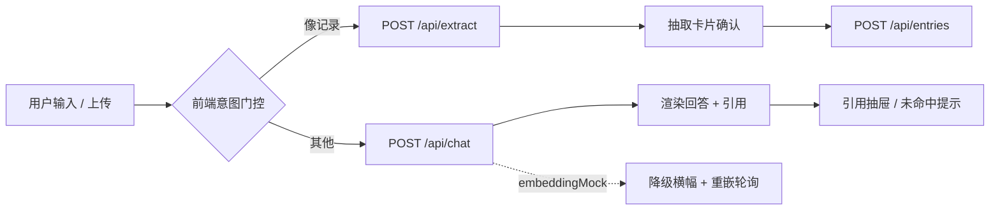
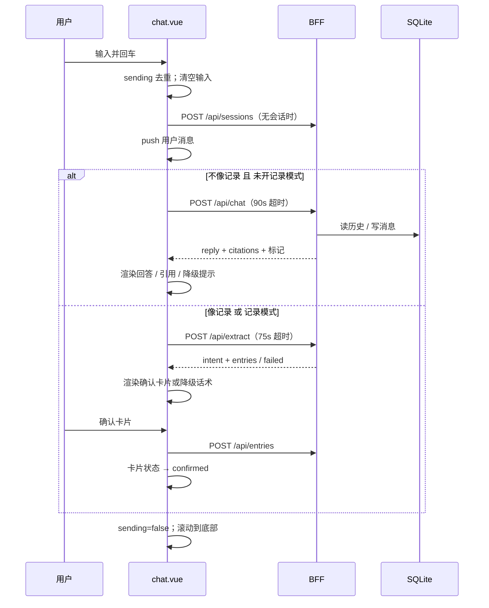

# 知识地图 × 前端实现分册

> 对象：`apps/generator`（Nuxt 3 + Vue 3 + Tailwind）、`apps/desktop`（Electron 外壳）
> 代码快照：2026-11-16
> 对照依据：知识地图六域（编排 / Agentic RAG / 上下文工程 / LLMOps / 模型路由 / AI 安全）
> 配套文档：[后端分册](./ai-knowledge-map-backend.md)

---

## 0. 前端在 AI 链路中的位置

一句话：**前端是薄客户端**。所有检索、生成、路由、预算、降级决策都在后端；前端负责输入、粗粒度意图分流、状态机、降级提示与引用交互。



| 能力        | 前端参与度 | 说明                                         |
| ----------- | ---------- | -------------------------------------------- |
| 编排        | 中         | 做“问答 vs 入库”的前置分流、卡片确认、状态机 |
| Agentic RAG | 低         | 上传与引用展示，不控制检索策略               |
| 上下文工程  | 极低       | 只发 `message + sessionId`，历史由后端读取   |
| LLMOps      | 低         | 消费降级字段、轮询重嵌状态，无成本/评测面板  |
| 模型路由    | 无         | 无模型选择 UI                                |
| AI 安全     | 中         | 输出转义、上传前置校验、Electron 隔离配置    |

### 0.1 六域现状速览

| #   | 知识域      | 前端现状                                                         | 主要文件                                                     |
| --- | ----------- | ---------------------------------------------------------------- | ------------------------------------------------------------ |
| 1   | 编排        | 双路径分流 + 非流式请求 + 三态消息 + 卡片确认                    | `pages/chat.vue`                                             |
| 2   | Agentic RAG | 上传→轮询解析→引用 chip→详情抽屉；无检索参数控制                 | `chat.vue`、`CitationList.vue`、`CitationDrawer.vue`         |
| 3   | 上下文工程  | 不拼装上下文；无 token/预算展示                                  | `chat.vue`、`utils/api.ts`                                   |
| 4   | LLMOps      | 展示 `embeddingMock/degraded/missing`；轮询重嵌；无成本/质量面板 | `chat.vue`                                                   |
| 5   | 模型路由    | 完全无感知                                                       | —                                                            |
| 6   | AI 安全     | Markdown 转义、上传格式校验、Electron 隔离                       | `utils/markdown.ts`、`chat.vue`、`desktop/src/main/index.ts` |

---

## 1. 编排 Orchestration（前端）

### 1.1 一次发送的完整时序



对应代码：`apps/generator/pages/chat.vue:869-940`。

关键事实：

- **防重入**：`if (!text || sending.value) return`，`sending` 同步置位，`finally` 复位（`chat.vue:870-873`、`:936-939`）。
- **无取消**：没有 `AbortController`，只能等超时；超时由 `apiPost` 的 `AbortSignal.timeout` 触发。
- **非流式**：`/api/chat` 使用一次性 JSON，不使用 SSE。后端虽提供 `/api/chat/completions` 的 SSE 能力，但前端未消费（全局未发现 `EventSource`）。
- **超时**：问答 90s，抽取 75s（`chat.vue:820`、`:894`）。

### 1.2 前置意图分流（前端唯一的“编排决策”）

```ts
// chat.vue:803-810
const looksLikeStorage = (text: string): boolean =>
  /记住|帮我记|记一下|记下来|记一条|记录一下|存一下|存一条|提醒我|别忘了|备忘|收藏一下|加个日程|帮我安排/.test(
    text,
  )
```

分流规则（`chat.vue:882-928`）：

1. `!recordMode && !looksLikeStorage(text)` → 走问答 `askAI()`。
2. 否则 → 走 `POST /api/extract`。
3. 抽取结果 `intent === 'record'` 且有条目 → 渲染卡片等待确认。
4. `failed` → 展示后端降级话术；若返回 `draftEntryId`，追加“原文已保存为草稿”。
5. 其他（`query` / `chat`）→ 回退到 `askAI()`，避免重复等待。

设计意图（代码注释 `:803-806`）：默认按问答处理是更安全的选择——把问题误判成存储会生成空卡片，反之只是少一次主动整理。

记录模式开关：`recordMode`，UI 位于输入区，提示“开启后输入的内容默认整理为记录”（`chat.vue:375-392`、`:513`）。

### 1.3 消息状态机

`UiMessage` 的关键字段（`chat.vue:451-490`）：

| 字段         | 作用         | 渲染分支                                      |
| ------------ | ------------ | --------------------------------------------- |
| `loading`    | 等待中       | 三点跳动占位（`:140-147`）                    |
| `error`      | 请求失败     | 红框“出错了：…”（`:149-155`）                 |
| `cards`      | 抽取候选卡片 | 卡片列表 + 全部确认（`:158-185`）             |
| `content`    | 普通回答     | Markdown 渲染（`:188-196`）                   |
| `citations`  | 引用列表     | 依据列表（`:203-208`）                        |
| `missing`    | 未命中项     | “未命中：…”（`:209-214`）                     |
| `degraded`   | 生成降级     | 黄色提示“回答生成超时或失败…”（`:197-202`）   |
| `general`    | 通用回答     | 不显示降级提示（条件 `degraded && !general`） |
| `attachment` | 上传附件     | 用户气泡中的文件名 + 大小（`:127-133`）       |

### 1.4 会话管理

- 无会话时 `POST /api/sessions`，标题取输入前 20 字（`chat.vue:624-627`）。
- 消息持久化：`POST /api/sessions/:id/messages`（`:632`）。
- 首次进入加载最新会话并还原消息与 `citations/missing/degraded`（`:655-678`）。
- 问答路径的持久化由后端完成（`/api/chat` 内部写两条消息）；抽取路径由前端手动 `persistMessage` 写摘要（`:900-902`）。

### 1.5 与地图的差距

| 地图概念      | 前端现状                    |
| ------------- | --------------------------- |
| 图状态可视化  | ❌ 无节点/边/执行轨迹展示   |
| 流式输出      | ❌ 对话页非流式             |
| 中断 / 恢复   | ❌ 无取消按钮、无断点续传   |
| 多 Agent 选择 | ❌ 无 Agent/工具选择器      |
| 人工确认节点  | ✅ 抽取卡片确认（局部实现） |

---

## 2. Agentic RAG（前端）

### 2.1 上传与入库反馈

流程（`chat.vue:704-780`）：

1. 选择文件后逐个处理；扩展名不支持时直接追加错误消息（`:723-731`）。
2. `ensureSession(file.name)` 确保有会话。
3. 添加上传 chip（`uploading`），并插入带 `attachment` 的用户消息。
4. `apiUpload('/api/documents/upload', FormData)`。
5. `waitForDocument`：最多 **25 次 × 700ms** 轮询 `GET /api/documents`，直到状态不再是 `processing`（`:704-717`）。
6. 根据终态给出话术：
   - `ready` → “解析成功”；
   - `processing` 超时 → “还在解析中”；
   - `failed` → “解析失败，可能是空文档、扫描件或格式不支持”（`:757-764`）。
7. 1.8s 后移除上传 chip（`:767`）。

客户端限制提示：文档页标注支持格式、**单文件 10MB**、PDF 需带文字层（`pages/documents.vue:38-42`）。真正的限制由后端 `multer` 与扩展名白名单兜底。

文档页另有“重新解析”“抽取为候选记录”“删除”操作，分别调用 `POST /:id/reprocess`、`POST /:id/extract`（90s 超时）、`DELETE /:id`（`documents.vue:377`、`:392`、`:422`）。

### 2.2 引用展示

渲染链（`utils/markdown.ts:12-32`）：

1. `escapeHtml` 先转义 `& < >`。
2. 交给 `marked` 渲染 Markdown（`breaks: true, gfm: true`）。
3. 把 `[n]` 替换为 `<button class="cite-chip" data-cite="n">n</button>`。
4. 点击通过容器事件委托解析 `data-cite`（`citationFromEvent`），打开引用抽屉。

组件分工：

| 组件                 | 职责                    | 关键行为                                                                                                                    |
| -------------------- | ----------------------- | --------------------------------------------------------------------------------------------------------------------------- |
| `CitationList.vue`   | “依据”列表 + 未命中提示 | 按 `entry/chunk/summary` 显示不同标签；`entry` 显示标题，`chunk` 显示“文档 · 片段 N”，`summary` 显示“汇总 N 条”（`:41-51`） |
| `CitationDrawer.vue` | 右侧抽屉详情            | 显示编号、标题、类型、时间、正文；重复事件标注“重复事件本次实例”；汇总行提示“共 N 条未逐条展示”（`:40-58`）                 |

### 2.3 检索质量的可视化

- **语义降级横幅**：`embeddingMock` 为真时显示“语义检索降级中…恢复后将自动重建索引”；重嵌中显示蓝色提示（`chat.vue:104-116`）。
- **重嵌轮询**：当 `embeddingMock` 从 `true` 变 `false` 时，启动 `pollReembedStatus`，每 **5s** 请求 `GET /api/cost/settings`，读取 `reembed.pending/inProgress`，完成即停止（`:827-867`）。
- **未命中**：展示 `missing` 列表（`:209-214`）。
- **无检索控制**：没有 topK、通道开关、rerank 开关、时间范围等 UI；这些全部由后端环境变量控制。

### 2.4 与地图的差距

| 地图概念       | 前端现状                           |
| -------------- | ---------------------------------- |
| 检索过程可视化 | ❌ 不展示三通道命中数、rerank 分数 |
| 检索策略调节   | ❌ 无参数面板                      |
| 查询分解展示   | ❌ 不显示凝练后的 query            |
| 多跳推理展示   | ❌ 无                              |
| 引用溯源       | ✅ chip → 抽屉，展示来源与片段     |

---

## 3. 上下文工程（前端）

### 3.1 前端实际发送的内容

```json
{ "message": "用户原始输入", "sessionId": "当前会话 id" }
```

- 前端**不拼装历史**，只传 sessionId；后端读取最近 12 条（见后端分册）。
- 前端**不注入记录/文档**；全部由后端检索后注入。
- 前端**不传 temperature / model / maxTokens**（`/api/chat` 不接受这些字段）。
- 上传附件时，附件内容走 `/api/documents/upload` 入库，聊天里只保留文件名与大小（`chat.vue:737-742`）。

### 3.2 前端持有的“上下文”

| 数据         | 位置                                      | 生命周期                     |
| ------------ | ----------------------------------------- | ---------------------------- |
| 当前会话消息 | `messages` 响应式数组                     | 页面会话内                   |
| 会话 id      | `sessionId`                               | 页面会话内                   |
| 记录模式     | `recordMode`                              | 页面会话内                   |
| 上传 chips   | `uploads`                                 | 上传完成 1.8s 后移除         |
| 语义降级状态 | `embeddingMock` / `reembeddingInProgress` | 页面会话内，由接口返回值驱动 |

### 3.3 与地图的差距

| 地图概念           | 前端现状                                        |
| ------------------ | ----------------------------------------------- |
| 上下文预算展示     | ❌ 无 token 计数、无预算占用                    |
| 上下文分层编辑     | ❌ 用户无法查看/编辑注入内容                    |
| 记忆管理入口       | ⚠️ 有独立记忆/日程/规划页，但不是“上下文编辑器” |
| Instruction 优先级 | ❌ 不可见、不可配置                             |

---

## 4. LLMOps（前端）

### 4.1 消费的运维信号

| 信号                          | 来源字段                  | UI 表现                    |
| ----------------------------- | ------------------------- | -------------------------- |
| `embeddingMock`               | `/api/chat` 响应          | 黄色降级横幅               |
| `reembeddingInProgress`       | `/api/cost/settings` 轮询 | 蓝色“正在重建语义索引”     |
| `degraded` + `degradedReason` | `/api/chat` 响应          | “回答生成超时或失败…”提示  |
| `empty`                       | `/api/chat` 响应          | 后端返回“没有相关内容”话术 |
| `missing`                     | `/api/chat` 响应          | “未命中：…”                |
| 请求耗时                      | 前端计时（无展示）        | ❌ 未展示                  |

### 4.2 不存在的面板

- 无成本仪表盘（`/api/cost/*` 只被用于重嵌状态）。
- 无评测结果页。
- 无日志查看器（日志查看是后端自带 HTML 页面 `/api/logs-view`，不在 Nuxt 应用内）。
- 无 trace/span 视图。

桌面端提供 Electron DevTools 用于本地排障（开发模式）。

### 4.3 与地图的差距

| 地图概念     | 前端现状                    |
| ------------ | --------------------------- |
| 成本可视化   | ❌                          |
| 质量指标面板 | ❌                          |
| 评测回归入口 | ❌                          |
| 告警中心     | ❌                          |
| 降级状态提示 | ✅ 局部（embedding / 生成） |

---

## 5. 模型路由（前端）

### 5.1 现状

- 对话页不传模型，也没有模型选择器。
- 后端 `/api/chat/completions` 支持 `model` 字段，但前端未调用该端点。
- 用户无法感知“当前用的是小模型还是大模型”，也无法手动切换。

### 5.2 与地图的差距

| 地图概念            | 前端现状 |
| ------------------- | -------- |
| 模型选择 / 路由展示 | ❌       |
| 成本-质量偏好设置   | ❌       |
| 每步模型可视化      | ❌       |

前端目前只消费路由的**结果**（质量、降级），不参与路由决策。

---

## 6. AI 安全（前端）

### 6.1 输出侧：XSS 防护

- 先 `escapeHtml`（`&`、`<`、`>`），再交给 `marked`；模型输出里的 `<script>` 只会显示为文字（`utils/markdown.ts:1-23`）。
- `v-html` 只用于 `renderAnswer(message.content)` 的返回值（`chat.vue:195`），没有其他 `v-html` 使用点。
- 引用 chip 使用 `data-cite` 数字属性，通过事件委托读取，不拼接 HTML 字符串以外的用户内容。

残余风险：Markdown 链接仍可指向任意 URL；点击后是否外开取决于浏览器/Electron 策略。

### 6.2 输入侧

| 控制       | 实现                            | 说明                                           |
| ---------- | ------------------------------- | ---------------------------------------------- |
| 空输入拦截 | `!text` 直接返回                | `chat.vue:871`                                 |
| 发送防重入 | `sending` 标志                  | `chat.vue:870-873`                             |
| 上传格式   | 客户端 `isSupported(file.name)` | 与后端白名单一致：txt / md / json / pdf / docx |
| 上传大小   | 页面提示 10MB                   | 最终由后端 `multer` 强制                       |
| 请求超时   | `AbortSignal.timeout`           | 90s / 75s                                      |

前端**没有**：注入检测、敏感词过滤、输入长度计数器（超长由 zod 返回错误）、文件内容扫描。

### 6.3 Electron 安全配置

| 配置               | 值                                              | 位置                                         |
| ------------------ | ----------------------------------------------- | -------------------------------------------- |
| `contextIsolation` | `true`                                          | `apps/desktop/src/main/index.ts:140`、`:485` |
| `nodeIntegration`  | `false`                                         | `:141`、`:486`                               |
| `sandbox`          | `false`（为注入进度脚本）                       | `:142`、`:487`                               |
| `preload`          | `../preload/index.js`                           | `:488`                                       |
| 外链打开           | IPC `OPEN_EXTERNAL` → `shell.openExternal(url)` | `:415-417`                                   |
| 文件拖拽           | preload 拦截 drop → `DESKTOP.FILE_DROPPED`      | `:463-467`                                   |

风险点：

- `sandbox: false` 降低了渲染进程隔离强度。
- `shell.openExternal(url)` 直接使用渲染进程传入的 URL，未见协议白名单校验。
- IPC 通道包含 `CHOOSE_DIRECTORY`、`SAVE_FILE`、`SET_API_KEY` 等敏感能力，需依赖 preload 的暴露范围控制。

### 6.4 与地图的差距

| 地图概念     | 前端现状                                      |
| ------------ | --------------------------------------------- |
| 输出内容审核 | ❌ 只有 HTML 转义                             |
| 间接注入提示 | ❌ 不提示“以下内容来自文档”                   |
| 出站链接管控 | ⚠️ Electron 直接 `openExternal`，无协议白名单 |
| 最小权限     | ⚠️ `sandbox: false`，IPC 能力较宽             |
| 安全事件提示 | ❌ 无                                         |

---

## 7. 前后端契约速查

| 端点                              | 请求                                  | 响应关键字段                                                                         | 前端使用位置                        |
| --------------------------------- | ------------------------------------- | ------------------------------------------------------------------------------------ | ----------------------------------- |
| `POST /api/chat`                  | `{ message, sessionId?, libraryId? }` | `reply, citations, missing, degraded, degradedReason, empty, general, embeddingMock` | `chat.vue:820`                      |
| `POST /api/extract`               | `{ text, sessionId? }`                | `intent, entries[], reply, failed?, draftEntryId?`                                   | `chat.vue:894`                      |
| `POST /api/documents/upload`      | multipart `file`                      | `{ id, name, status }`                                                               | `chat.vue:748-751`                  |
| `GET /api/documents`              | —                                     | `DocumentRow[]`（含 `status`）                                                       | `chat.vue:708`、`documents.vue:217` |
| `POST /api/documents/:id/extract` | `{}`                                  | 候选条目                                                                             | `documents.vue:392`                 |
| `POST /api/entries`               | 条目字段                              | 创建结果                                                                             | `chat.vue:950`、`documents.vue:411` |
| `POST /api/sessions`              | `{ title }`                           | `SessionSummary`                                                                     | `chat.vue:626`                      |
| `POST /api/sessions/:id/messages` | `{ role, content }`                   | `SessionMessage`                                                                     | `chat.vue:632`                      |
| `GET /api/sessions/:id`           | —                                     | 会话详情 + 消息                                                                      | `chat.vue:657`                      |
| `GET /api/cost/settings`          | —                                     | `reembed: { pending, inProgress }`                                                   | `chat.vue:846-849`                  |
| `GET /api/reminders`              | —                                     | 提醒列表                                                                             | `chat.vue:533`                      |

统一封装（`utils/api.ts:13-64`）：

- `baseUrl` 来自 `runtimeConfig.public.bffUrl`（`nuxt.config.ts:14-17`，读取 `BFF_URL`，默认 `http://localhost:3001`）。
- `apiFetch` 统一处理超时、HTTP 错误体、JSON 解析；`204` 返回 `undefined`。
- `apiUpload` 走 `FormData`，不手写 `Content-Type`。

---

## 8. 前端文件地图

| 文件                                      | 职责                                                         |
| ----------------------------------------- | ------------------------------------------------------------ |
| `pages/chat.vue`                          | 对话主页面：发送、意图分流、状态机、上传、卡片确认、降级展示 |
| `pages/documents.vue`                     | 资料库：上传、解析状态、重解析、抽取候选、删除               |
| `pages/plans.vue`                         | 规划列表：筛选、编辑、删除                                   |
| `pages/schedule.vue`                      | 日程/事实视图                                                |
| `utils/api.ts`                            | 请求封装、超时、错误处理、类型定义                           |
| `utils/markdown.ts`                       | 回答渲染、引用 chip、转义                                    |
| `utils/documents.ts`                      | 支持格式判断等文档工具                                       |
| `components/CitationList.vue`             | 依据列表 + 未命中                                            |
| `components/CitationDrawer.vue`           | 引用详情抽屉                                                 |
| `components/EntryCard.vue`                | 抽取卡片：确认/编辑/忽略                                     |
| `layouts/default.vue`                     | 侧栏数据：提醒、规划、文档                                   |
| `nuxt.config.ts`                          | RuntimeConfig、模块、代理配置                                |
| `apps/desktop/src/main/index.ts`          | Electron 主进程：窗口、IPC、外链                             |
| `apps/desktop/src/main/spawnServer.ts`    | 启动后端                                                     |
| `apps/desktop/src/main/spawnGenerator.ts` | 启动 Nuxt                                                    |
| `apps/desktop/src/main/waitForPort.ts`    | 端口就绪探测                                                 |

---

## 9. 前端侧优先级建议（与知识地图对齐）

| 优先级 | 建议                                                      | 对应知识域        | 现有可复用点                              |
| ------ | --------------------------------------------------------- | ----------------- | ----------------------------------------- |
| P0     | 对话页改为流式渲染，并支持取消                            | 编排              | 后端已有 `/api/chat/completions` SSE 实现 |
| P0     | 增加“上下文/引用来源”展开区，显式标注资料内容边界         | 上下文工程 / 安全 | `citations` 已含来源与片段                |
| P1     | 增加检索调试面板（三通道命中数、rerank 分数、凝练 query） | Agentic RAG       | 后端响应已可扩展字段                      |
| P1     | 增加成本与降级状态面板                                    | LLMOps            | `/api/cost/*` 已有完整接口                |
| P2     | 增加模型/质量偏好设置（快速 vs 深度）                     | 模型路由          | `/api/chat/completions` 已支持 `model`    |
| P2     | Electron `openExternal` 增加协议白名单                    | AI 安全           | IPC 已有集中入口                          |
| P2     | 增加注入/异常输入提示（仅提示，不拦截）                   | AI 安全           | 现有错误通道可复用                        |
