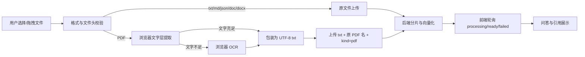
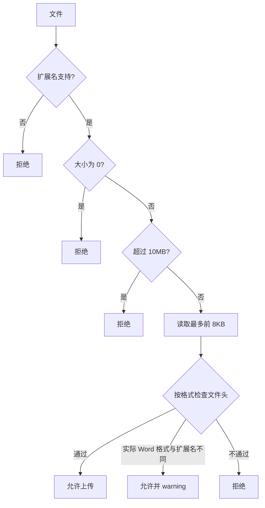
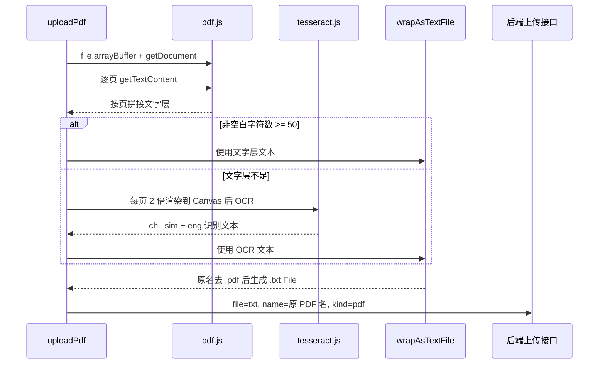

# 前端向量化完整流程

> 文档日期：2026-11-15  
> 适用范围：Nuxt 3 前端的文件校验、PDF 文字层提取/OCR、上传、处理轮询、个人记录向量化触发、知识问答与引用展示。  
> 编写依据：当前仓库实际代码。后端分片、Embedding、存储和检索细节见《后端向量化完整流程》。

## 1. 前端在向量化中的职责

前端**不计算文档语义向量，也不直接写向量数据库**。它负责把输入整理成后端可处理的文本或文件，并驱动后续状态流转：



前端共有五项核心职责：

1. 上传前拦截不支持的格式、空文件、超 10MB 文件和明显错误的文件头；
2. PDF 在浏览器中提取文字层，文字不足时自动 OCR；
3. 调用上传接口，并轮询直到后台处理结束；
4. 用户确认个人记录时调用 `/api/entries`，间接触发条目向量化；
5. 发起问答，渲染回答与检索引用。

---

## 2. 前端代码模块地图

| 模块           | 文件                                                               | 职责                                                             |
| -------------- | ------------------------------------------------------------------ | ---------------------------------------------------------------- |
| 文档管理页     | [documents.vue](apps/generator/pages/documents.vue)                | 完整文件校验、按格式上传、PDF 预处理、轮询、重试、提取记录、删除 |
| 对话页         | [chat.vue](apps/generator/pages/chat.vue)                          | 文件/URL 导入、问答与记录意图分派、引用展示、会话恢复            |
| PDF 提取器     | [pdfExtract.ts](apps/generator/utils/pdfExtract.ts)                | pdf.js 文字层、tesseract.js OCR、进度、txt 包装                  |
| 文件格式与校验 | [documents.ts](apps/generator/utils/documents.ts)                  | 格式配置、文件头校验、文档徽标                                   |
| API 封装       | [api.ts](apps/generator/utils/api.ts)                              | `apiGet/apiPost/apiUpload`、超时、错误消息、响应类型             |
| 回答渲染       | [markdown.ts](apps/generator/utils/markdown.ts)                    | Markdown 渲染、`[n]` 转可点击引用按钮                            |
| 引用列表       | [CitationList.vue](apps/generator/components/CitationList.vue)     | 展示引用编号、文档名/片段序号、类型、未命中项                    |
| 引用抽屉       | [CitationDrawer.vue](apps/generator/components/CitationDrawer.vue) | 展示引用摘要、来源、条目时间                                     |

---

## 3. 两个文件上传入口并不相同

当前前端有两条文件上传路径，不能混为一套能力：

| 能力                         | 文档管理页 `documents.vue`      | 对话页 `chat.vue`                |
| ---------------------------- | ------------------------------- | -------------------------------- |
| 文件数量                     | 单文件                          | 可多文件，逐个处理               |
| 格式校验                     | 扩展名 + 空文件 + 10MB + 文件头 | 只检查扩展名                     |
| PDF 浏览器文字层提取         | 有                              | 无，原 PDF 直接上传              |
| PDF 扫描件浏览器 OCR         | 有                              | 无                               |
| 上传后保留 PDF 名与 PDF 徽标 | 有，附 `name/kind=pdf`          | 原文件本身即 PDF，无额外覆盖字段 |
| 轮询时长                     | 75 次 × 2 秒，约 150 秒         | 25 次 × 700ms，约 17.5 秒        |
| 最终提示                     | 显示块数、warning 或后端 error  | 显示成功、仍在解析或通用失败提示 |
| 失败重试                     | 有“重新解析”按钮                | 无单独重试按钮                   |

因此，“PDF 扫描件可走浏览器 OCR”目前只适用于**文档管理页**。从对话页直接上传扫描 PDF，仍会由后端 `pdf-parse` 尝试提取文字层，可能失败。

---

## 4. 文档管理页：完整上传链路

### 4.1 文件来源

用户可以通过两种方式选择文件：

- 点击“上传文档”，触发隐藏的 `input[type=file]`；
- 把文件拖到上传区域。

两者最终都调用同一个 `upload(file)`，所以校验、PDF 提取、上传与轮询逻辑一致。文件选择后清空 input 的值，允许再次选择同一个文件。

### 4.2 支持格式与展示配置

支持：`.txt/.md/.json/.pdf/.docx/.doc`。

每种格式在 `DOCUMENT_FORMATS` 中独立配置：

- `key`：格式标识；
- `extensions`：允许的扩展名；
- `badge`：列表短标签；
- `badgeClass`：标签颜色；
- `hint`：能力说明。

`DOC_ACCEPT` 用于文件选择器，`DOC_LIST_HINT` 用于界面提示，避免多处手写格式列表。

### 4.3 上传前校验

`checkFile(file)` 的顺序如下：



文件头规则：

| 格式        | 校验                                                         |
| ----------- | ------------------------------------------------------------ |
| PDF         | 必须 `%PDF` 开头；通过后直接返回，不再进入文本 NUL 检查      |
| docx        | 应为 ZIP `PK\x03\x04`；若是 OLE2，则允许并提示实际是旧版 doc |
| doc         | 应为 OLE2 `D0CF11E0...`；若是 ZIP，则允许并提示实际是 docx   |
| txt/md/json | 前 8KB 出现 NUL 字节则视为二进制并拒绝                       |

这些检查只是减少无效请求，后端仍会独立识别真实格式，前端校验不能替代服务端校验。

### 4.4 按格式分派上传方法

`uploadByFormat(file, format)` 是统一分派器：

```text
pdf                       → uploadPdf(file)
txt/md/json/docx/doc      → uploadRaw(file)
```

`upload()` 本身只负责：

1. 设置全局上传状态；
2. 调用 `checkFile`；
3. 调用 `uploadByFormat`；
4. 刷新列表并等待后台处理；
5. 根据最终状态显示结果；
6. 清理上传和 PDF 进度状态。

新增格式时，可以在格式配置和分派器中增加独立方法，而不需要把所有预处理塞回 `upload()`。

### 4.5 普通文件：原样上传

`uploadRaw(file)` 构造：

```text
FormData
  file = 原始 File
```

请求：`POST /api/documents/upload`。

`apiUpload` 不手动设置 `Content-Type`，由浏览器自动生成带 boundary 的 multipart 头。普通文件不在浏览器做文本转换，编码识别、Word 解析、归一化、分片与向量化全部由后端完成。

---

## 5. PDF 浏览器提取与 OCR

### 5.1 为什么需要前端预处理

后端 PDF 解析器只能提取已有文字层。扫描件或图片型 PDF 往往没有文字层，直接上传会得到空文本或“需要 OCR”错误。

文档管理页因此先把 PDF 转为纯文本，再复用后端稳定的 `.txt` 链路。后端不需要引入 OCR 运行时，OCR 的 Canvas、Worker 和语言包都由浏览器处理。

### 5.2 SSR 安全的依赖加载

`pdfjs-dist` 与 `tesseract.js` 依赖浏览器 DOM、Canvas 或 Worker，不能在 Nuxt SSR 阶段求值。当前实现：

- 模块顶层不导入这两个重依赖；
- `loadPdfJs` 在函数内动态 `import('pdfjs-dist')`；
- worker 文件通过 `pdf.worker.min.mjs?url` 获取打包 URL；
- OCR 仅在需要时动态 `import('tesseract.js')`；
- `extractPdfText` 首行检查 `window`，非浏览器环境直接报“PDF 提取只能在浏览器中执行”。

### 5.3 主流程



### 5.4 文字层提取

`extractTextLayer` 逐页执行：

1. `pdf.getPage(pageNumber)`；
2. `page.getTextContent()`；
3. 遍历文本 item，利用 `transform[5]` 的 Y 坐标变化识别换行；
4. 同一行拼接 `item.str`；
5. 每页文本用换行组织；
6. 页与页之间插入 `\n\n--- 分页 ---\n\n`。

进度状态为 `stage=text/method=text`，`current/total` 表示当前页和总页数。

提取后计算：

```text
meaningful = textLayer.replace(/\s/g, '').length
```

只有非空白字符数达到 50，才接受文字层结果。这个阈值是对**整篇 PDF**判断，不是每页独立判断。

### 5.5 OCR 兜底

整篇文字层不足 50 个非空白字符时，转为对整篇 PDF 做 OCR：

- 每页按 `scale=2` 渲染到 Canvas；
- 使用 `chi_sim + eng` 同时识别中文和英文；
- 单页 OCR 超时 30 秒；
- 页间同样插入分页标记；
- 无论成功或失败，最后都 `worker.terminate()`；
- PDF 处理结束后 `pdf.cleanup()`；
- OCR 最终没有任何文本时，提示可能是纯图片或图片质量过低。

当前实现使用 OCR 结果作为最终文本，**不会把少量已有文字层与 OCR 结果合并**。

### 5.6 OCR 的使用条件与代价

- 首次使用通常需要下载中英文语言包，依赖网络，体积约 10–20MB；
- OCR 在浏览器本地执行，占用 CPU 和内存；
- 页数多、分辨率高时，10MB 以内的 PDF 也可能处理较久；
- 单页 30 秒超时是识别上限，不是整篇 PDF 总超时；
- 上传大小限制仍按原 PDF 的 10MB 校验，生成 txt 后还受后端上传限制约束。

### 5.7 进度反馈

`PdfExtractProgress.stage` 包括：

| stage     | 页面提示       |
| --------- | -------------- |
| `loading` | 加载 PDF       |
| `text`    | 提取文字层     |
| `ocr`     | OCR 识别扫描件 |
| `done`    | 完成           |

文档页将进度写进 notice，显示当前阶段、页码与百分比。`pdfProgress` 同时保存结构化进度，但当前模板主要通过文字 notice 呈现，没有独立进度条组件。

### 5.8 包装为文本并保留 PDF 展示身份

`wrapAsTextFile(originalName, text)`：

- 去掉原名末尾 `.pdf`；
- 新建 `原 base 名.txt`；
- MIME 为 `text/plain;charset=utf-8`。

`uploadPdf` 最终发送：

```text
FormData
  file = 提取后的 .txt File
  name = 原始 PDF 文件名
  kind = pdf
```

这三个字段分别承担不同职责：

| 字段   | 后端用途                                       |
| ------ | ---------------------------------------------- |
| `file` | 真实待解析内容；后端按 `.txt` 选择文本解析器   |
| `name` | `documents.name`，列表仍显示原 PDF 名          |
| `kind` | `documents.metadata.kind`，列表仍显示 PDF 徽标 |

如果 OCR 成功，提示“已通过 OCR 识别 N 页扫描件”；文字层成功则提示“已提取 N 页文字”。随后才进入网络上传。

---

## 6. 上传后的处理轮询

### 6.1 为什么必须轮询

`/api/documents/upload` 在后台任务开始前就返回 `processing`。前端不能把这个响应当成向量化完成，必须继续查询文档列表。

### 6.2 文档页轮询策略

`waitProcessed(docId)`：

```text
最多循环 75 次：
  等待 2 秒
  GET /api/documents（刷新完整列表）
  找到目标文档：
    status != processing → 返回该文档
    文档消失 → 返回 undefined
超时后返回当前文档状态
```

总等待约 150 秒，用于覆盖后端默认 120 秒文档处理超时。

### 6.3 结果提示

`reportResult` 按最终状态处理：

| 状态            | 前端反馈                                                  |
| --------------- | --------------------------------------------------------- |
| `ready`         | “解析成功，共 N 个片段”；若有 warning，附带第一条 warning |
| `failed`        | 直接展示后端 `error`，没有则显示未知原因                  |
| 其他/文档不存在 | 提示仍在解析，可稍后刷新或重新解析                        |

文档列表同时展示：

- 文件名称与格式徽标；
- 文件大小；
- `chunk_count`；
- 创建日期；
- 状态：已就绪/解析中/解析失败；
- 错误或 warning。

顶部的“N 篇可检索”只统计 `status=ready`，不是按上传成功数统计。

### 6.4 徽标选择

`documentBadge(doc)` 优先使用后端返回的 `kind`，其次才根据文件名扩展名推断。因此 PDF 转 txt 上传后，只要 `kind=pdf` 被保存，列表仍显示 PDF，而不会退化为 TXT。

---

## 7. 重试、删除与“提取为记录”

### 7.1 重新解析

失败文档点击“重新解析”：

1. `POST /api/documents/:id/reprocess`；
2. 刷新列表；
3. 复用文档页约 150 秒的 `waitProcessed`；
4. 复用 `reportResult` 显示结果。

重试期间用 `reprocessing` 保存文档 ID，防止重复点击。

### 7.2 删除

删除前弹出确认框，提示相关片段会一并删除。确认后：

- `DELETE /api/documents/:id`；
- 成功后直接从本地 `rows` 移除；
- 向量与片段清理由后端负责，前端不操作向量表。

### 7.3 提取为记录与二次向量化

`POST /api/documents/:id/extract` 只是把已分块内容交给 LLM 抽取候选记录，**不会立即生成个人条目向量**。

真正的条目向量触发发生在用户确认卡片时：

```text
EntryCard 确认
  → POST /api/entries
  → 后端创建 entry
  → 后端对 title + "\n" + content 生成向量
  → 写 entry_embeddings
```

前端将卡片状态置为 `confirmed`。如果卡片被忽略或仅编辑但尚未确认，不会调用 `/api/entries`，也就不会生成条目向量。

这条链路与文档上传时生成的 `chunks.embedding` 相互独立：同一文档可以既有文档块向量，也有用户确认后的多个条目向量。

---

## 8. 对话页的文件与 URL 导入

### 8.1 文件上传

对话页支持点击“+ → 上传文件”、隐藏文件选择器多选，以及整页拖拽。每个文件按顺序处理：

1. 仅检查扩展名；
2. 确保会话存在；
3. 添加附件消息与上传 chip；
4. 原始文件直接 `POST /api/documents/upload`；
5. 每 700ms 拉一次文档列表，最多 25 次；
6. 根据状态显示成功、失败或仍在解析；
7. 将上传事件与反馈写入会话消息。

`waitForDocument` 对单次列表请求失败会继续尝试，但等待预算总共约 17.5 秒，明显短于文档页。超时只是不再等待，**不会取消后端处理**；文档之后仍可能变为 `ready`。

当前 chip 状态只在明确 `failed` 时标为 error，其余情况（包括仍在处理）会标为 done，再通过文字说明“还在解析中”。

### 8.2 与文档页 PDF 能力的差异

对话页没有调用 `checkFile/uploadByFormat/uploadPdf/extractPdfText`，所以：

- 不做前端文件头与 10MB 预检，仍受后端限制；
- PDF 原样上传；
- 扫描件没有浏览器 OCR 兜底；
- 不展示 PDF 页级进度；
- 后端解析失败时使用通用提示，不直接展示具体 `doc.error`。

### 8.3 URL 导入

“+ → 粘贴链接”调用：

```http
POST /api/rag/documents/url
Content-Type: application/json

{"url":"https://..."}
```

该接口同步完成网页抓取、分片、向量化和存储，前端不经过 `/api/documents/upload`，也不执行 processing 轮询。成功后显示“《文档名》解析成功”，并将导入事件和反馈写入会话。

当前后端已给该接口加废弃响应头，但前端仍在使用，界面不会展示这个废弃信息。

---

## 9. 问答如何触发知识库检索

### 9.1 发送时的意图分派

`send()` 先确保会话存在，再决定走问答还是记录整理：

```mermaid
flowchart TD
    A[用户发送文本] --> B{recordMode 开启?}
    B -->|否| C{包含记住/提醒/安排等存储关键词?}
    B -->|是| D[/api/extract]
    C -->|否| E[askAI → /api/chat]
    C -->|是| D
    D --> F{抽取结果}
    F -->|record 且有候选卡片| G[展示卡片，等待确认]
    F -->|抽取失败| H[展示降级话术]
    F -->|非记录意图| E
    G -->|用户确认| I[/api/entries → 条目向量化]
```

普通问题默认直接进入 `/api/chat`，后端在回答前先执行知识检索。只有“记一下”模式或明显存储意图才先走 `/api/extract`。

### 9.2 问答请求

`askAI` 使用：

```http
POST /api/chat
Content-Type: application/json
前端超时：90 秒
```

```json
{
  "message": "用户问题",
  "sessionId": "当前会话 ID"
}
```

前端没有传 `libraryId`，后端使用默认值 `default`；也没有传 topK、检索模式或相似度阈值，这些全部由后端控制。

调用期间先插入一个带 `loading=true` 的助手消息。拿到响应后更新同一个响应式对象，避免接口已返回但页面一直转圈。

### 9.3 前端接收的回答信息

`ChatAnswer` 类型包含：

| 字段                                         | 前端用途                   |
| -------------------------------------------- | -------------------------- |
| `reply`                                      | 助手回答正文               |
| `citations`                                  | 文档/条目/汇总引用         |
| `missing`                                    | 未命中内容提示             |
| `degraded`                                   | 是否走了生成降级           |
| `degradedReason`                             | 超时、模型失败、未找到等   |
| `empty`                                      | 检索是否为空               |
| `general`                                    | 是否通用回答               |
| `embeddingMock`                              | 后端当前是否处于 hash 降级 |
| `sessionId/userMessageId/assistantMessageId` | 持久化关联 ID              |

当前页面实际写入消息状态的是 `reply/citations/missing/degraded/general`。`embeddingMock` 虽有 TypeScript 类型和后端响应，但**没有保存到 UI 消息，也没有向用户显示降级警告**。

### 9.4 降级提示

当 `degraded=true` 且不是通用回答时，页面显示：

> 回答生成超时或失败，以上是检索到的相关记录。

检索为空时，后端直接返回固定“未找到”话术，前端按普通回答展示。

---

## 10. 引用渲染与查看

### 10.1 回答中的 `[n]`

`renderAnswer` 的处理顺序：

1. 先转义原始 HTML，防止模型输出注入标签；
2. 用 marked 渲染 Markdown，开启 GFM 与换行；
3. 将 `[数字]`（1–2 位）替换为带 `data-cite` 的按钮。

因此模型输出的 `[1]` 不只是文本，而会变成可点击引用 chip。

### 10.2 点击回答引用

点击事件通过容器委托处理：

1. `citationFromEvent` 找到最近的 `[data-cite]` 元素；
2. 读取数字；
3. 在当前消息 `citations` 中查找同编号项；
4. 设置为 `activeCitation`；
5. 打开 `CitationDrawer`。

编号依赖后端“注入上下文编号 = citations.num”的约定，前端不重新推断引用来源。

### 10.3 引用列表

`CitationList` 在回答下方显示“依据”区域：

- 条目：显示条目标题与类型；
- 文档块：显示 `文档名 · 片段 chunkIndex+1`；
- 汇总：显示汇总文本和剩余条数；
- `missing` 非空时显示“未命中：……”。

点击列表项与点击回答中的 `[n]` 都会打开同一个抽屉。

### 10.4 引用抽屉

抽屉展示：

- 引用编号；
- 文档名或条目标题；
- 类型；
- 条目时间/重复事件实例信息；
- 引用摘要；
- 来源。

文档引用显示的是后端生成的 `snippet`（最多 120 字符），前端没有再根据 `docId/chunkId` 请求完整 chunk，也没有 PDF 页码定位或原文件预览。

### 10.5 历史会话恢复

进入对话页时：

1. 拉取会话列表；
2. 有会话则读取最新会话详情；
3. 恢复 user/assistant 消息；
4. 恢复 `message.citations`；
5. 从 metadata 恢复 `missing/degraded`；
6. 将“上传文档：……”消息还原为附件样式。

引用由后端随助手消息持久化，因此历史回答仍能显示当时的引用快照，而不是重新执行一次检索。

---

## 11. 前端 API 一览

| API                                          | 前端调用位置           | 与向量化的关系                                 |
| -------------------------------------------- | ---------------------- | ---------------------------------------------- |
| `POST /api/documents/upload`                 | 文档页、对话页         | 创建文档并启动后端分块/Embedding               |
| `GET /api/documents`                         | 文档页、对话页         | 轮询处理状态、块数、错误与展示 kind            |
| `POST /api/documents/:id/reprocess`          | 文档页                 | 重新触发解析与向量生成                         |
| `DELETE /api/documents/:id`                  | 文档页                 | 删除文档及关联数据                             |
| `POST /api/documents/:id/extract`            | 文档页                 | 从现有 chunks 抽取候选记录，不直接生成条目向量 |
| `POST /api/entries`                          | 文档页卡片、对话页卡片 | 新建条目并触发条目 Embedding                   |
| `POST /api/rag/documents/url`                | 对话页                 | 同步网页抓取、分块、Embedding                  |
| `POST /api/chat`                             | 对话页                 | 查询向量化、混合检索、回答与引用               |
| `POST /api/extract`                          | 对话页                 | 记录意图抽取；确认后才进入条目向量化           |
| `POST /api/sessions`                         | 对话页                 | 问答/上传前确保会话存在                        |
| `POST /api/sessions/:id/messages`            | 对话页                 | 保存上传事件及非问答反馈                       |
| `GET /api/sessions`、`GET /api/sessions/:id` | 对话页                 | 恢复历史回答与引用                             |

普通 API 通过 `apiFetch` 处理 JSON、错误体与可选超时；multipart 通过独立 `apiUpload` 处理，不手动设置 boundary。

---

## 12. 参数与限制汇总

| 参数                 |            当前值 | 所在位置                   |
| -------------------- | ----------------: | -------------------------- |
| 文件大小上限         |              10MB | 文档页前端校验；后端也限制 |
| 前端文件头读取       |    最多 8192 字节 | `checkFile`                |
| PDF 文字层有效阈值   |   50 个非空白字符 | `extractPdfText`           |
| OCR 渲染倍率         |                 2 | `ocrPage`                  |
| OCR 语言             |   `chi_sim + eng` | `ocrPdf`                   |
| 单页 OCR 超时        |             30 秒 | `ocrPage`                  |
| 文档页轮询           |         75 × 2 秒 | `waitProcessed`            |
| 对话页轮询           |        25 × 700ms | `waitForDocument`          |
| 文档提取接口前端超时 |             90 秒 | `extract`                  |
| 对话问答前端超时     |             90 秒 | `askAI`                    |
| 记录抽取前端超时     |             75 秒 | `send`                     |
| 引用摘要             | 后端最多 120 字符 | 前端只展示                 |

---

## 13. 异常与状态处理矩阵

| 场景                        | 前端行为                                     |
| --------------------------- | -------------------------------------------- |
| 不支持的扩展名              | 上传前提示，不发请求                         |
| 空文件/超过 10MB/文件头错误 | 文档页上传前拦截；对话页主要依赖后端拒绝     |
| PDF 文字层充足              | 浏览器转 txt 后上传，保留 PDF 名与 kind      |
| PDF 文字层不足              | 自动整篇 OCR，再转 txt 上传                  |
| OCR 无结果                  | 提示图片或识别质量问题，不上传空文本         |
| OCR 单页超时                | 抛出页码错误，终止 worker，显示处理失败      |
| 上传接口返回 processing     | 开始轮询，不视为已经可检索                   |
| 后端最终 ready              | 显示成功与片段数                             |
| 后端最终 failed             | 文档页显示具体 error；对话页显示通用失败提示 |
| 轮询超时                    | 不取消后台任务；提示仍在处理或稍后重试       |
| 普通问题                    | 直接 `/api/chat`，后端先检索再回答           |
| 记录意图                    | 先 `/api/extract`，用户确认后 `/api/entries` |
| 回答生成降级                | 显示检索结果与降级提示，引用仍可查看         |
| 网络/请求失败               | 在消息区或 notice 显示 Error.message         |

---

## 14. 当前实现边界与一致性说明

1. **两个上传入口能力不一致。** 文档页有完整校验和 PDF/OCR，对话页没有；用户从对话页上传扫描 PDF，体验与文档页不同。
2. **文档页提示文案存在不一致。** 拖拽区仍写“PDF 需带文字层”，但格式说明和实现已经支持扫描件浏览器 OCR。
3. **PDF 转 txt 后的重新解析有风险。** 首次上传通过 `name/kind` 保留 PDF 展示；重试接口使用展示名选择解析器，可能把实际 txt 原件按 `.pdf` 误判，并丢失 kind 覆盖。前端目前只是调用重试，无法修正这个后端参数问题。
4. **对话页轮询时间较短。** 约 17.5 秒后只提示仍在解析，不会持续跟踪到最终状态；用户可能需要稍后自行确认文档页状态。
5. **OCR 是整篇回退。** 文字层不足 50 字时，不保留已有文字层与 OCR 的混合结果；大文档会消耗较多本地资源。
6. **前端看不到向量本身。** 上传列表只有块数，检索详情、向量分、BM25 分和 mock 状态需通过后端调试接口查看。
7. **`embeddingMock` 未展示。** 虽然问答响应包含该字段，当前 UI 不提示语义检索已降级，用户可能只看到“关键词能搜、语义搜不到”。
8. **引用不是原文预览。** 当前只展示短摘要，没有完整块、PDF 页码或原文件跳转。
9. **URL 导入仍走废弃接口。** 功能可用，但后续端点迁移需要同步修改对话页。

---

## 15. 端到端验证清单

### 15.1 普通文档

- [ ] txt/md/json/doc/docx 能通过对应校验并原样上传；
- [ ] 上传后先出现“解析中”，最终变“已就绪”；
- [ ] `chunk_count > 0`，顶部可检索数量增加；
- [ ] 用文档中的连续中文词组提问，可以命中并显示引用。

### 15.2 文字层 PDF

- [ ] 进度显示“提取文字层”；
- [ ] 不进入 OCR；
- [ ] 实际上传文件为 txt，但列表名称仍是原 PDF 名；
- [ ] 徽标仍为 PDF；
- [ ] 最终块数大于 0，问答引用显示 PDF 文档名与片段序号。

### 15.3 扫描 PDF

- [ ] 从**文档管理页**上传；
- [ ] 文字层不足后进入 OCR，页码与百分比更新；
- [ ] OCR 完成后显示识别页数；
- [ ] 最终状态 ready，能用 OCR 文本中的内容提问；
- [ ] 从对话页上传同一文件时，不要把结果与文档页 OCR 路径混为一谈。

### 15.4 个人记录向量

- [ ] “记一下”或文档“提取为记录”只产生候选卡片；
- [ ] 未确认前不调用 `/api/entries`；
- [ ] 确认后创建条目并触发后端条目 Embedding；
- [ ] 修改标题/正文会重算，单纯改状态不重算；
- [ ] active 条目可通过个人语义通道参与问答。

### 15.5 问答与引用

- [ ] 普通问题直接调用 `/api/chat`，而非先走记录抽取；
- [ ] 回答 `[n]` 可点击；
- [ ] 引用列表与抽屉编号、文档名、片段序号一致；
- [ ] 生成超时时显示降级提示和检索记录；
- [ ] 刷新并恢复最新会话后，历史引用仍可打开；
- [ ] 若语义结果异常，调用后端 `/api/search` 与 `/api/cost/settings` 检查 BM25、cosine 和 mock 状态。
