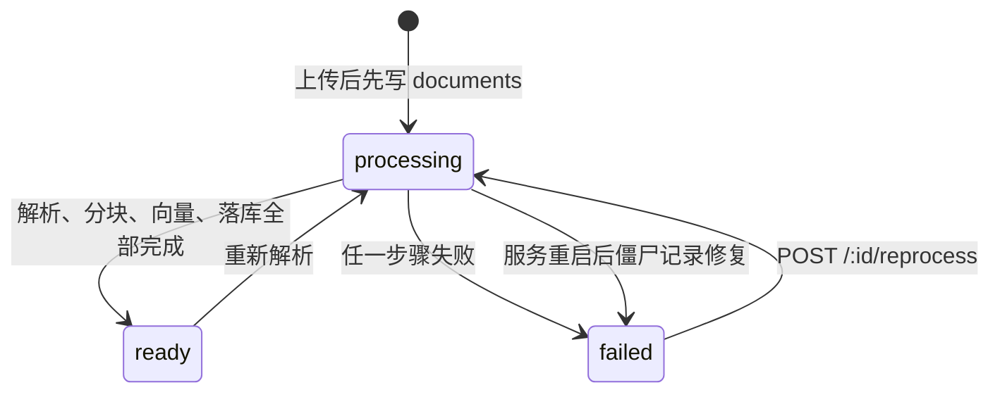
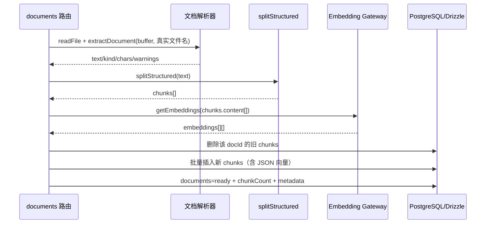
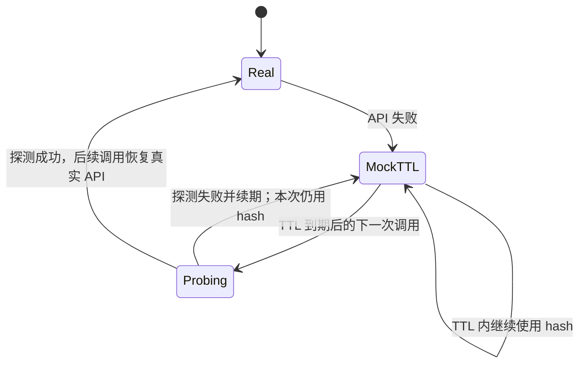

# 后端向量化完整流程

> 文档日期：2026-11-15  
> 适用范围：个人知识库的文档块向量、个人条目向量、混合检索、回答与引用。  
> 编写依据：当前仓库实际代码，而非单独的架构设计稿。前端配合流程见《前端向量化完整流程》。

## 1. 核心结论

当前系统有两条向量数据链路：

1. **文档块向量**：文件或网页 → 纯文本 → 文档分块 → 每个块生成 1536 维向量 → 写入 `chunks`，供资料问答检索。
2. **个人条目向量**：条目标题与正文 → 生成向量 → 写入 `entry_embeddings`，供“我的日程、计划、事实、笔记”等个人记忆检索。

Embedding 统一由后端生成。浏览器只负责文件校验、PDF 文字提取/OCR、上传与状态展示，不在前端计算语义向量。

文档问答的主链路如下：


系统统一使用 PostgreSQL + pgvector。文档和条目向量以 `vector(1536)` 原生类型保存，语义检索通过数据库内 cosine distance 与 HNSW 索引完成。

---

## 2. 代码模块地图

| 模块               | 文件                                                                                                                   | 职责                                                              |
| ------------------ | ---------------------------------------------------------------------------------------------------------------------- | ----------------------------------------------------------------- |
| 文档主上传路由     | [documents.ts](apps/server/src/routes/documents.ts)                                                                    | 接收 multipart、创建文档记录、异步解析/分块/向量化、重试与删除    |
| RAG 编排入口       | [index.ts](apps/server/src/services/rag/index.ts)                                                                      | Loader → Splitter → Embeddings → VectorStore；向量/BM25/RRF 检索  |
| 文档类型识别       | [detect.ts](apps/server/src/services/documents/detect.ts)                                                              | 文件头识别真实格式，处理扩展名不一致                              |
| 文档解析注册表     | [index.ts](apps/server/src/services/documents/index.ts)                                                                | 选择 txt/md/json/pdf/docx/doc 解析器，统一文本归一化              |
| 文本解析           | [text.ts](apps/server/src/services/documents/parsers/text.ts)                                                          | UTF BOM、UTF-8、GB18030 解码                                      |
| PDF 后端解析       | [pdf.ts](apps/server/src/services/documents/parsers/pdf.ts)                                                            | `pdf-parse` 文字层提取、超时与错误提示                            |
| 主分片器           | [splitterPure.ts](apps/server/src/services/rag/splitterPure.ts)                                                        | 标题 → 段落/代码 → 句子 → 硬切的四级分片                          |
| LangChain 分片封装 | [splitter.ts](apps/server/src/services/rag/splitter.ts)                                                                | 可选 `RecursiveCharacterTextSplitter`，不是主上传路由使用的分片器 |
| Embedding 门面     | [embeddings.ts](apps/server/src/services/rag/embeddings.ts)                                                            | 对外暴露单个/批量向量接口                                         |
| Embedding 实现     | [embeddingGateway.ts](apps/server/src/services/rag/embeddingGateway.ts)                                                | API 调用、并发、超时、hash 降级、TTL 自愈、余弦函数               |
| 向量存储           | [vectorStore.ts](apps/server/src/services/rag/vectorStore.ts)                                                          | `chunks` 写入、pgvector cosine KNN、向量删除                      |
| BM25               | [bm25.ts](apps/server/src/services/rag/bm25.ts)                                                                        | 中文 2-gram、英文单词、CJK 空格折叠、BM25 排名                    |
| 文档语义通道       | [docChannel.ts](apps/server/src/services/search/docChannel.ts)                                                         | 调用 RAG 混合检索，过滤低相关文档块                               |
| 条目向量维护       | [entryIndex.ts](apps/server/src/services/search/entryIndex.ts)                                                         | 新建/修改条目时同步向量，删除时清理                               |
| 条目语义通道       | [entrySearch.ts](apps/server/src/services/search/entrySearch.ts)                                                       | 条目向量 + BM25 → RRF                                             |
| 统一检索           | [searchAll.ts](apps/server/src/services/search/searchAll.ts)                                                           | 查询理解、三通道并行、合并、可选 rerank                           |
| 三通道合并         | [merge.ts](apps/server/src/services/search/merge.ts)                                                                   | 相邻块合并、通道归一化、加权、条数限制                            |
| 回答生成           | [generate.ts](apps/server/src/services/answer/generate.ts)                                                             | 上下文、模型调用、降级与结构化回答                                |
| 上下文与引用       | [context.ts](apps/server/src/services/answer/context.ts)、[citations.ts](apps/server/src/services/answer/citations.ts) | 编号注入、预算裁剪、引用快照                                      |
| 问答入口           | [chat.ts](apps/server/src/routes/chat.ts)                                                                              | 历史、多轮查询凝练、检索、回答、消息持久化                        |
| 检索调试入口       | [search.ts](apps/server/src/routes/search.ts)                                                                          | 返回三通道得分与 `embeddingMock` 状态                             |
| 数据库             | [index.ts](apps/server/src/db/index.ts)、[schema.ts](apps/server/drizzle/schema.ts)                                    | PostgreSQL 连接、Drizzle schema、连接池生命周期                   |

---

## 3. 数据模型与状态

### 3.1 关键表

| 表                 | 关键字段                                                                      | 用途                           |
| ------------------ | ----------------------------------------------------------------------------- | ------------------------------ |
| `documents`        | `id/name/storage_path/status/chunk_count/library_id/metadata`                 | 文档主记录与处理状态           |
| `chunks`           | `id/doc_id/content/chunk_index/token_count/embedding/created_at/extracted_at` | 文档块正文与 vector(1536) 向量 |
| `entry_embeddings` | `entry_id/embedding/model/updated_at`                                         | 个人条目向量，一条目一向量     |
| `messages`         | `content/citations/metadata`                                                  | 持久化回答、引用快照与降级信息 |

`chunks.embedding` 和 `entry_embeddings.embedding` 均为 PostgreSQL 原生 `vector(1536)`，并建立 HNSW cosine 索引。

### 3.2 文档状态机



- `processing`：上传接口立即返回的状态，后台任务仍在执行。
- `ready`：已写入块与向量，`chunk_count` 已更新，可参与检索。
- `failed`：`metadata.error/errorCode/failedAt` 记录可读失败原因。
- 拉取文档列表时，`recoverStaleProcessing` 会把超过僵尸阈值仍为 `processing` 的记录修正为 `failed`，错误码为 `PROCESS_INTERRUPTED`。

### 3.3 错误分类

| 错误码                | 触发情况                            |
| --------------------- | ----------------------------------- |
| `PARSE_TIMEOUT`       | 文档处理超过总超时，或 PDF 解析超时 |
| `SCANNED_PDF`         | 错误文本包含扫描件/OCR 特征         |
| `UNSUPPORTED_CONTENT` | 格式不支持或文件内容无效            |
| `PARSE_FAILED`        | 其他解析、分块、向量化或写库异常    |
| `PROCESS_INTERRUPTED` | 服务重启/崩溃留下的僵尸处理记录     |

---

## 4. 文档上传与入库主链路

### 4.1 上传接口

主接口：`POST /api/documents/upload`。

- `multer` 接收字段名 `file`，单文件最大 10MB。
- 支持 `.txt/.md/.json/.pdf/.doc/.docx`。
- multipart 文件名从 busboy 默认 latin1 转回 UTF-8，避免中文文件名乱码。
- 可选表单字段：
  - `name`：展示名称；
  - `description`：可选描述；
  - `kind`：展示类型，枚举 `txt/md/json/pdf/docx/doc`。
- `name/kind` 只覆盖展示信息；解析器仍根据实际上传文件的 `file.originalname` 与文件头选择。

```json
{
  "id": "文档 UUID",
  "name": "展示文件名",
  "status": "processing"
}
```

接口先插入 `documents(status=processing, chunkCount=0)`，再通过 `void processDocument(...)` 启动后台任务，不等待解析和向量化完成。因此，“上传接口成功”不等于“文档已可检索”，必须等到 `ready`。

### 4.2 后台处理顺序

`processDocument` 的实际顺序为：



注意：**先删旧块、再写新块**。这样重复处理不会叠加旧片段，但如果后续插入失败，文档会进入 `failed`，旧块已经被清理。

### 4.3 格式识别与文本提取

`extractDocument` 先通过 magic bytes 判断真实类型，再调用对应解析器：

| 类型              | 识别与解析                                                                         |
| ----------------- | ---------------------------------------------------------------------------------- |
| txt/md/json       | 非二进制文本；依次识别 UTF-8 BOM、UTF-16 LE/BE BOM、严格 UTF-8，失败后回退 GB18030 |
| pdf               | `%PDF-` 文件头；`pdf-parse` 提取文字层，默认 60 秒超时                             |
| docx              | ZIP/OOXML，检查 `word/document.xml`；mammoth 为主并有兼容回退                      |
| doc               | OLE2，检查 Word 目录项；使用旧版 Word 解析器与回退                                 |
| xls/xlsx/ppt/pptx | 识别后明确报“不支持”，不会误当 Word                                                |

对于前端已经转成 `.txt` 的 PDF，后端实际走的是 **文本解析器**，不会再次运行 `pdf-parse`。`kind=pdf` 仅保证列表仍显示 PDF 名称与徽标。

### 4.4 文本归一化

解析后、分块前执行：

1. 去除 BOM；
2. CRLF/CR 统一为 LF；
3. 清理换行前的空格/Tab；
4. 4 个及以上连续换行压缩为 3 个；
5. 折叠 CJK 字符之间的空格/Tab；
6. `trim()`；
7. 空文本直接报错，不写 `ready`。

CJK 折叠会把“龚 熙 皓”处理为“龚熙皓”。它只处理空格和 Tab，不吞掉换行，避免破坏标题与段落结构。这一步同时改善正文展示和 BM25 中文匹配。

---

## 5. 四级结构化分片

主函数：`splitStructured(text, options)`。主上传路由和通用 RAG 入库都使用它；`simpleSplit` 仅是纯硬切兜底，LangChain 分片器是另一套可选封装。

### 5.1 参数

| 参数              |   默认值 | 含义                           |
| ----------------- | -------: | ------------------------------ |
| `CHUNK_TARGET`    | 600 字符 | 目标块大小                     |
| `CHUNK_MIN`       |  80 字符 | 小于该值的块尝试并入前块       |
| `CHUNK_OVERLAP`   |  80 字符 | 无标点超长文本硬切时的重叠     |
| `CHUNK_HARD_MAX`  | 900 字符 | 单块硬上限，句子过长时触发硬切 |
| `CHUNK_MAX_COUNT` |   500 块 | 单文档最大块数，超过直接抛错   |

这里的 `tokenCount` 实际等于字符数，不是模型 tokenizer 的 token 数。

### 5.2 四级策略

**第一级：Markdown 标题结构块**

- 识别 `#` 到 `######` 标题；
- 用标题栈维护 `headingPath`；
- 标题行保留在对应块开头；
- 代码围栏内的 `#` 不当标题；
- 跨标题结构块不合并，避免不同章节混成一块。

**第二级：段落与代码单元**

- 空行作为段落边界；
- 代码围栏整体保留；
- 小单元按目标 600 字符合并；
- 文本与代码类型不同则不合并；
- 超过目标的单元降级到句子切分；代码块未超过硬上限时可整体保留。

**第三级：中英文句读切分**

- 按 `。！？；!?;` 等句读切句；
- 逐句累积到目标大小；
- 尽量保持语义句子完整。

**第四级：硬切与重叠**

- 单句超过 `hardMax`，或文本没有可用标点时，按目标长度硬切；
- 相邻硬切块保留 80 字符重叠，降低上下文被截断的概率。

最后，小于 80 字符且类型相同的块会并入前块；总块数超过 500 会报“文档过大”。

### 5.3 分片元数据与持久化差异

分片器在内存中生成：

- `tokenCount`；
- `headingPath`；
- `charStart/charEnd`；
- `contentType=text/code`；
- `index` 与临时块 ID。

但当前 `chunks` 表及两条入库实现只持久化正文、`chunkIndex`、向量和时间等少数字段。**`headingPath`、字符偏移、`contentType` 没有写入数据库；主上传路由也没有给 `token_count` 赋值。** 因而这些结构化信息主要在当前分片过程或通用 RAG 返回值中可见，不会全部成为后续检索元数据。

---

## 6. Embedding 向量化

### 6.1 真实 API 调用

默认配置：

| 项         | 默认值                                 |
| ---------- | -------------------------------------- |
| API 地址   | `https://open.bigmodel.cn/api/paas/v4` |
| 模型       | `embedding-3`                          |
| 维度       | 1536                                   |
| 单请求超时 | 15000ms                                |
| 批量并发   | 4                                      |

请求形状：

```http
POST {AI_API_URL}/embeddings
Authorization: Bearer {AI_API_KEY}
Content-Type: application/json
```

```json
{
  "model": "embedding-3",
  "input": "一个文档块的完整文本"
}
```

成功时读取 `data[0].embedding`，并按 API 返回的 `usage` 记录成本。查询向量与文档块向量使用同一个 `getEmbedding` 入口，确保正常情况下处于同一向量空间。

### 6.2 批量处理与顺序保证

`getEmbeddings(texts)` 使用 worker pool：

- 创建 `min(并发数, 文本数)` 个 worker；
- 每个 worker 从共享游标取下一个下标；
- 结果写回 `results[i]`，所以输出顺序与输入块顺序一致；
- 单个文本失败会单独降级为 hash 向量，不中断其他块；
- 强制 mock 时直接同步生成所有 hash 向量，不发网络请求。

实现上还有一个细节：批量函数自身会捕获 `getEmbedding` 的异常并写入 hash。因此即使设置了 `DISABLE_EMBEDDING_FALLBACK=1`，批量入口仍有最后一道 hash 兜底；该开关对单个 `getEmbedding` 调用更直接。

### 6.3 hash 降级向量

当 API 返回非 2xx、网络异常或超时，且未禁用单次调用的降级时，系统进入 mock 状态并生成确定性伪随机向量：

1. 对文本做 SHA-256；
2. 取哈希种子初始化 Mulberry32 PRNG；
3. 用 Box-Muller 变换生成正态分布数；
4. 生成 1536 维向量；
5. 做 L2 归一化。

特性：

- 相同文本得到完全相同的向量；
- 不依赖外部 API，上传与检索不会仅因 Embedding 服务故障而整体崩溃；
- 不同文本的向量方向近似随机，**不具备可靠语义相似度**；
- 它主要用于保留系统可用性，此时真正有效的文档召回主要依赖 BM25。

### 6.4 TTL 自愈机制



- `ENABLE_MOCK_EMBEDDING=1` 时直接生成 hash 向量，不调用真实 API，也不进入上述 TTL 自愈流程。
- 默认 TTL 为 300000ms（5 分钟），可由 `EMBEDDING_MOCK_TTL_MS` 调整。
- 到期后用短文本 `probe` 异步探测，探测超时最多 5 秒。
- 触发探测的本次调用仍返回 hash；探测成功后，后续调用才恢复真实 API。
- `probing` 防止并发重复探测。
- `mockUntil/probing` 是进程内状态，服务重启会重置。
- `isMockMode()` 表示当前全局降级状态，不标识某一条历史向量究竟由真实模型还是 hash 生成。

### 6.5 运维注意事项

- 文档入库期间如果 API 中途失败，同一篇文档可能出现真实向量与 hash 向量混合。
- API 恢复不会自动重算旧 hash 向量。若降级期间导入过资料，建议恢复后重新解析或重建受影响文档。
- 更换 Embedding 模型时必须同时考虑维度与历史向量重建；当前 vector 列、hash 向量和存储层常量均按 1536 维设计。

---

## 7. pgvector 向量持久化

### 7.1 主上传路由的写入

`/api/documents/upload` 的 `processDocument` 使用 Drizzle：

- 每块生成 `randomUUID()`；
- 写入 `docId/content/chunkIndex/embedding/createdAt`；
- 向量直接以 `number[]` 绑定到 `chunks.embedding vector(1536)`；
- 批量插入后更新文档为 `ready`。

### 7.2 通用 RAG 存储层的写入

`createRAGService().ingestDocumentWithId` 调用 `vectorStore.addDocuments`：若块没有向量则补调 `getEmbedding`，随后同样以原生 vector 类型批量写入 `chunks`。两条路径不再维护额外的向量副本。

### 7.3 初始化

部署前先执行 `pnpm --filter @ai-study/server db:init`。脚本启用 pgvector，创建 `vector(1536)` 列与 HNSW cosine 索引；运行时只做连接和结构探针，不隐式执行 DDL。

---

## 8. 重新解析、删除与条目向量维护

### 8.1 文档重新解析

`POST /api/documents/:id/reprocess`：

1. 检查文档与 `storagePath` 原件存在；
2. 删除旧 `chunks`；
3. 文档重置为 `processing/chunkCount=0`，清旧错误；
4. 异步执行 `processDocument`；
5. 立即返回 `processing`。

### 8.2 文档删除

`DELETE /api/documents/:id` 删除 `chunks`、`documents`，并尝试删除磁盘原件。通用 `DELETE /api/rag/documents/:id` 通过 `vectorStore.deleteByDocId` 删除对应文档块，再删除文档主记录。

### 8.3 个人条目向量

`POST /api/entries` 新建条目后，后端同步执行：

```text
embeddingInput = title + "\n" + content
vector = getEmbedding(embeddingInput)
删除旧 entry_embeddings → 插入新向量与模型名
```

具体规则：

- 新建后生成向量；
- PATCH 只有标题或正文变化才重新生成；仅状态变化不重新向量化；
- 删除条目前显式删除向量；
- 向量写入失败只记日志，不阻止条目 CRUD；
- 条目本身不再分块，一条目对应一个向量；
- 检索只读取 `active` 条目，最多取最近更新的 500 条，向量分批每批最多 400 个 ID。

文档“提取为记录”与对话“记一下”最终确认到 `/api/entries` 后，也会进入这条向量链路。它与文档块向量是两套独立存储，不是把同一向量复制两份。

---

## 9. 查询时的向量检索

### 9.1 问答入口

主接口：`POST /api/chat`。

```json
{
  "message": "用户问题",
  "sessionId": "可选会话 ID",
  "libraryId": "default"
}
```

处理顺序：

1. 有 `sessionId` 时校验会话并读取最近 12 条消息，反转为旧→新；只保留 user/assistant。
2. `ENABLE_QUERY_CONDENSATION=1` 且有历史时，可将追问改写成独立检索问题。
3. 用改写后的 `searchQuery` 调 `searchAll`。
4. 用用户原始问题、检索结果和历史调 `generateAnswer`。
5. 有会话时保存用户消息与助手消息；助手消息保存 `citations` 快照和降级元数据。
6. 返回回复、引用、空结果、通用问题与当前 embedding 降级状态。

### 9.2 查询理解

`searchAll` 先做规则理解：

- 识别今天、明天、本周、最近 N 天等时间窗口；
- 根据“我/咱/安排/日程/记录”等线索判断是否依赖个人上下文；
- 若规则已能明确判断，或调用方要求跳过模型，则不调用 LLM；
- 否则使用轻量模型输出 `needsPersonalContext/timeRange/keywords/entityTypes`；失败时回退规则结果。

`ENABLE_DECIDE_SKIP_DOC=1` 时，通用且无时间窗口的问题可跳过文档通道。默认未开启，文档通道会始终尝试一次，避免“某人是誰”被误判为通用问题后完全不查上传资料。

### 9.3 三通道并行

| 通道         | 执行条件                       | 主要来源                       |
| ------------ | ------------------------------ | ------------------------------ |
| 时间通道     | 需要个人上下文且存在时间窗口   | 时间范围内的日程/条目实例      |
| 条目语义通道 | 需要个人上下文                 | `entries` + `entry_embeddings` |
| 文档语义通道 | 默认始终执行，除非显式开启跳过 | `chunks` + pgvector HNSW       |

三个通道通过 `Promise.all` 并行。文档通道自身失败会记 warning 并返回空数组，不拖垮另外两路。

### 9.4 文档通道的完整调用层次

```text
searchAll
  └─ searchDocumentsSemantic(query, k=15)
      └─ createRAGService().search(query, 15, hybrid)
          ├─ vectorStore.similaritySearch(query, 45)
          ├─ bm25Search(query, 45)
          └─ rrfFuse → 取 Top 15
      └─ 原始相关性过滤
```

当前向量检索与 BM25 在 `createRAGService().search` 内是**先后 await**，不是并行；三通道层级才是并行。

### 9.5 向量路：pgvector cosine KNN

1. 查询文本生成向量；
2. 如果调用方传入 `docId`，先在 SQL 中过滤对应文档块；
3. 使用 `embedding <=> queryVector` 计算 cosine distance；
4. 使用 `similarity = 1 - distance` 作为相似度；
5. 在 PostgreSQL 中按距离升序并执行 `LIMIT k`，利用 HNSW 索引返回候选。

过滤、算分、排序和限制数量均在数据库内完成，不在 JavaScript 中反序列化或扫描全部向量。

### 9.6 条目语义候选池

条目检索先从 pgvector 取出最多 `k × 3` 个候选，再与最近 500 条目的 BM25 候选通过 RRF 合并；对不在最近行窗口内的向量命中会补取条目内容。mock/hash 模式跳过条目向量通道。

### 9.7 BM25 关键词路

BM25 从 `chunks` 读取正文，在当前候选集合上实时计算：

```text
score = Σ IDF(q) × [tf(q,d) × (k1+1)] /
                   [tf(q,d) + k1 × (1-b+b×dl/avgdl)]
k1 = 1.2，b = 0.75
```

分词规则：

- 先折叠 CJK 字符之间的空格/Tab；
- 转小写并按中英文标点、空白等分隔；
- 纯 ASCII 文本保留长度大于 1 的整词；
- 中文及中英混合内容抽取英文单词，并对剩余中文做 2-gram 滑动窗口；
- 单个中文字符也可成为 token。

例如“龚熙皓”会产生“龚熙、熙皓”，入库和查询使用同一套折叠与分词逻辑，因此可以匹配 PDF 文字层中原本带空格的中文姓名。

### 9.8 RRF 融合

向量与 BM25 各产生一个有序列表，按排名而不是直接比较原始分：

```text
RRF(d) = Σ 1 / (60 + rank(d))
rank 从 1 开始
```

- 同一块同时出现在两路，会把两项分数相加；
- 返回融合列表前 K 个；
- 同时回填 `vectorScore`、`bm25Score` 和 `source`；
- 也支持 `mode=vector` 或 `mode=bm25` 单路调试。

RRF 分是排名分，不是相似度概率，数值通常很小。即使某块没有真实相关性，只要进入候选列表，也可能得到正的 RRF 分，因此后面还需要原始分过滤。

### 9.9 文档相关性兜底

`searchDocumentsSemantic` 对 Top 15 再过滤：

```text
若 bm25Score <= 0 且（当前为 mock 或 cosine < 0.35），丢弃该块
```

含义：

- 真实 Embedding 模式下，BM25 没命中时，至少要求 cosine ≥ 0.35；
- mock 模式下 hash 向量没有可靠语义，BM25 没命中就直接丢弃；
- 有正向 BM25 命中时可以保留，即使向量分较低。

这与条目通道略有不同：条目通道在 mock 时直接不加载/计算向量，只让 BM25 参与 RRF；文档通道仍可能计算 hash 相似度，但最终由上述过滤阻断无语义结果。

### 9.10 三通道合并

`mergeSearchSignals` 做以下处理：

1. 同一条目同时被时间与语义通道命中时，保留时间实例，去掉重复语义条目；
2. 同一文档的相邻 `chunkIndex` 合并正文，只保留一次引用，分数取各项最大值；
3. 每个“来源 + 类型”组按组内最高分归一化到 0–1；
4. 乘通道权重：时间 1.3、语义条目 1.0、文档块 0.8；
5. 按加权分降序，时间通道优先于同分语义项；
6. 最终最多 15 项：条目 ≤10、文档块 ≤5；剩余内容形成汇总行。

`ENABLE_RERANK=1` 且结果大于 1 条时，可在合并后再调用 LLM rerank；失败回退合并顺序。

---

## 10. 回答生成与引用

### 10.1 通用问题与空结果

- 若最终判断不依赖个人上下文，或明确是外部工具问题：不注入个人记录，走通用回答，无引用区。
- 若需要个人上下文且检索为空：直接返回“你的记录里没有相关内容……”，不再调用生成模型，`degradedReason=not_found`。
- 通用问题若文档通道确实命中，会把上下文判断修正为个人资料问答，避免资料已经命中却仍走无引用通用回答。
- 个人问题三通道全空、但问题没有明显个人归属线索时，可回退为通用问答，避免寒暄被误答为“没有记录”。

### 10.2 上下文预算

`assembleContext` 将检索结果变为带编号的 `[个人记录]` 与 `[资料片段]`：

| 项目         | 字符预算 |
| ------------ | -------: |
| 单条条目     |      160 |
| 单个文档块   |      400 |
| 全部注入内容 |     3200 |

代码注释中的 token 预算是设计目标；实际实现没有 tokenizer，按字符上限执行。超出总预算的低优先级项不注入、不编号，也不生成引用。

`ENABLE_CONTEXT_COMPRESS=1` 时，可先让 LLM 将超预算内容压缩为与问题相关的摘要；失败则回退硬截断。

### 10.3 引用编号与模型约束

- 注入上下文的编号与 `citations.num` 使用同一序号。
- 文档引用包含 `docId/docName/chunkIndex/snippet`，摘要最多 120 字符。
- 个人记录引用包含条目类型、标题、时间与摘要。
- 超出 15 条的汇总行使用固定编号 16。
- 系统提示要求个人信息只能依据注入记录回答，每个相关陈述带 `[n]`，找不到的信息明确说未找到。

### 10.4 生成失败降级

- 默认回答超时 30 秒；
- 个人资料回答超时或模型失败时，不继续重试，直接返回编号检索结果列表；
- 此时 `degraded=true`，`degradedReason=timeout/llm_error`，已有引用仍返回；
- 通用回答分支没有同样的检索列表可回退，其异常由路由统一错误处理。

### 10.5 回答响应

```json
{
  "ok": true,
  "reply": "带 [1] 编号的回答",
  "citations": [
    {
      "num": 1,
      "type": "chunk",
      "id": "chunk UUID",
      "docId": "document UUID",
      "docName": "资料.pdf",
      "chunkIndex": 0,
      "snippet": "引用摘要"
    }
  ],
  "missing": [],
  "degraded": false,
  "degradedReason": null,
  "empty": false,
  "general": false,
  "embeddingMock": false,
  "sessionId": "会话 ID",
  "userMessageId": "用户消息 ID",
  "assistantMessageId": "助手消息 ID"
}
```

---

## 11. 其他入口与兼容链路

### 11.1 URL 导入

`POST /api/rag/documents/url`：

- 仅允许 http/https；
- fetch 超时 15 秒，页面最大 2MB；
- HTML 移除脚本、样式、导航等噪音，块级标签转换行，解码 HTML entities；
- 非 HTML 直接按文本；
- 空内容报错；
- 走 `ingestFromUrlWithId → splitStructured → embedDocuments → vectorStore.addDocuments`；
- 同步等待处理完成后返回 `chunkCount`，失败会把文档置为 `failed`。

该路由当前标记 `Deprecation: true`、`Sunset: 2026-12-31`，但前端对话页仍在调用它。

### 11.2 旧同步文件上传

`POST /api/rag/documents` 同样已标记废弃。它同步等待通用 RAG 入库后返回，与主 `/api/documents/upload` 的异步处理不同。

### 11.3 检索调试

`POST /api/search` 与聊天共用 `searchAll`，返回：

- 查询理解结果与时间窗口；
- 三通道命中数 `channels.time/entry/doc`；
- 每项最终分、通道分、向量分、BM25 分；
- 汇总行与 `empty`；
- `degraded.embeddingMock`。

排查“没有调用知识库”时，优先看这个接口，而不是直接看最终 LLM 回答。

### 11.4 兼容 RAG 问答

`POST /api/rag/query` 也复用 `searchAll`，但只保留 `kind=chunk` 的文档结果，再按可选 `documentIds/topK` 后过滤，最后自行组装 prompt，支持 SSE 流式输出。它不是当前对话页的主问答接口。

---

## 12. 配置项汇总

| 环境变量                     | 默认值        | 影响                                                               |
| ---------------------------- | ------------- | ------------------------------------------------------------------ |
| `AI_API_URL`                 | 智谱 v4 地址  | Embedding 与聊天 API 基础地址                                      |
| `AI_API_KEY`                 | 空            | Embedding 鉴权                                                     |
| `EMBEDDING_MODEL`            | `embedding-3` | 向量模型与条目向量模型标记                                         |
| `EMBEDDING_TIMEOUT_MS`       | 15000         | 单次向量请求超时，最低 1000ms                                      |
| `EMBEDDING_CONCURRENCY`      | 4             | 文档块批量向量并发                                                 |
| `ENABLE_MOCK_EMBEDDING`      | 未开启        | `1` 强制全部使用 hash                                              |
| `DISABLE_EMBEDDING_FALLBACK` | 未开启        | `1` 时单个 `getEmbedding` 失败直接抛错；批量入口仍有最终 hash 捕获 |
| `EMBEDDING_MOCK_TTL_MS`      | 300000        | mock 状态持续时间，最低 5000ms                                     |
| `DATABASE_URL`               | 无            | 必填，PostgreSQL + pgvector 连接串                                 |
| `DOC_PROCESS_TIMEOUT_MS`     | 120000        | 单篇后台处理超时，最低 10000ms                                     |
| `DOC_STALE_PROCESSING_MS`    | 180000        | 僵尸 processing 判定阈值，最低 30000ms                             |
| `DOC_PDF_TIMEOUT_MS`         | 60000         | 后端 PDF 文字层解析超时，最低 5000ms                               |
| `ENABLE_QUERY_CONDENSATION`  | 未开启        | `1` 开启多轮查询凝练                                               |
| `CONDENSATION_TOPIC_GATE`    | 非 `0`        | 查询凝练的话题门控                                                 |
| `ENABLE_DECIDE_SKIP_DOC`     | 未开启        | `1` 时通用问题可跳过文档通道                                       |
| `ENABLE_RERANK`              | 未开启        | `1` 开启合并后 LLM 重排                                            |
| `ENABLE_CONTEXT_COMPRESS`    | 未开启        | `1` 开启问题相关上下文压缩                                         |

---

## 13. 日志与诊断

### 13.1 关键日志点

| 日志模块            | 可观察内容                                                |
| ------------------- | --------------------------------------------------------- |
| `documents.route`   | 上传入口/出口、后台处理完成、失败原因、僵尸记录修复       |
| `embedding.service` | 单次向量成功、API 失败、进入 hash、TTL 续期、恢复真实 API |
| `rag.service`       | 通用入库块数与耗时、检索模式/路数/结果数                  |
| `search.all`        | 查询理解来源、三通道命中数、最终展示数                    |
| `answer`            | 回答生成超时或失败                                        |
| `chat.route`        | 查询凝练、引用数、空结果、通用/降级状态                   |

### 13.2 状态接口

`GET /api/cost/settings` 返回：

- `embeddingMockEnabled`：是否强制 mock；
- `embeddingMockState`：当前是否 active、到期时间、剩余 TTL；
- `embeddingFallbackDisabled`；
- `embeddingConcurrency`；
- 聊天模型降级状态。

### 13.3 常见故障定位

| 现象                 | 优先检查                                                                               |
| -------------------- | -------------------------------------------------------------------------------------- |
| 上传成功但一直不能问 | 文档是否已到 `ready`，而非只收到上传接口的 `processing`                                |
| `failed`             | `metadata.error/errorCode`；是否为空文本、格式错误、超时、块数超过 500                 |
| 搜索 `doc=0`         | 用 `/api/search` 看原始通道；检查 `embeddingMock`、BM25 是否为 0、cosine 是否低于 0.35 |
| 只有精确关键词能搜到 | 很可能处于 hash 降级；查 `/api/cost/settings` 与 embedding 日志                        |
| API 恢复后语义仍差   | 旧文档可能仍是 hash 向量，需要重新解析/重建                                            |
| 中文姓名或词组搜不到 | 检查文本是否仍有 CJK 间空格，以及入库和查询是否都经过当前折叠逻辑                      |
| 回答没有引用         | 是否走了 `general=true`，或文档被相关性过滤，或上下文预算裁掉                          |
| 文档语义召回异常     | 检查 pgvector 扩展、`vector(1536)` 列与 HNSW 索引是否已由 `db:init` 创建               |

---

## 14. 当前实现边界与一致性说明

以下是代码现状，使用或扩展系统时需要特别注意：

1. **向量写入路径统一。** 主文档路由和通用 VectorStore 都直接写 PostgreSQL vector 列，无额外向量副本需要同步。
2. **PDF 转换文档的重试存在名称风险。** 首次上传时，实际文件是 `.txt`，展示名可以是 `.pdf`；重新解析却用 `doc.name` 选择解析器，且未继续传 `kindOverride`。因此这类文档重试可能把文本原件误判为 PDF，并丢失展示类型覆盖。
3. **结构化分片元数据未完整落库。** 标题路径、偏移、内容类型和 tokenCount 不会全部保留到 `chunks`，后续无法仅凭当前表恢复完整标题上下文。
4. **BM25 仍是全量计算。** 向量检索已由 pgvector 承担；数据量大时 BM25 仍需要持久化倒排索引或缓存。
5. **文档通道不按 `libraryId` 过滤。** `libraryId` 会传给时间/条目通道，但 `searchDocumentsSemantic` 当前没有接收它；文档检索是在全部 `chunks` 上进行。
6. **mock 状态不是向量血缘。** 当前没有按块记录模型、向量类型或生成版本，无法仅从数据库自动识别哪些旧块需要重算。
7. **hash 降级保证可用性，不保证语义质量。** 不能将“接口仍返回结果”理解为“语义检索仍正常”。
8. **向量与 BM25 两路在文档 RAG 内串行。** 若需降低检索延迟，可单独优化为并行，但这与 `searchAll` 三通道并行是两个不同层级。

---

## 15. 一次完整请求的最小检查清单

### 入库验收

- [ ] 上传响应返回文档 ID 与 `processing`；
- [ ] 最终文档状态为 `ready`；
- [ ] `chunk_count` 大于 0；
- [ ] `chunks` 中该文档的块数与 `chunk_count` 一致；
- [ ] 每块 `embedding` 为预期维度的 pgvector 向量；
- [ ] `chunks` 和 `entry_embeddings` 的 HNSW cosine 索引存在；
- [ ] 若处于 mock，明确标记这批资料后续需要重建。

### 检索验收

- [ ] `/api/search` 的 `channels.doc` 大于 0；
- [ ] 目标块同时查看 `vectorScore/bm25Score/score`，不只看 RRF 分；
- [ ] mock 下至少应有 BM25 正分；
- [ ] 合并后目标文档块未被 5 条上限或上下文预算裁掉；
- [ ] `/api/chat` 返回的 `citations` 与回答 `[n]` 编号一致；
- [ ] 历史消息中的引用快照可正常恢复。
