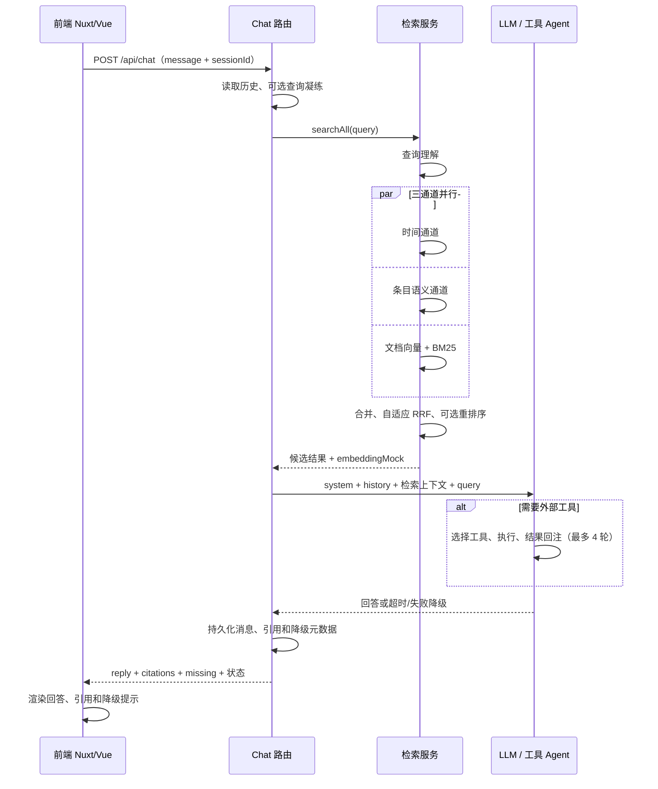

# 项目前后端知识地图对照

> 本文依据当前项目代码，对照“编排、Agentic RAG、上下文工程、LLMOps、模型路由、AI 安全”六个知识域，说明前端与后端分别如何实现，以及当前尚未覆盖的能力。

## 一、总体结论

截图中的整体判断基本准确，但有两点需要修正：

1. 项目已经不只是“单轮固定管线 + RRF”，还具备查询凝练、自适应 RRF、可选重排序和工具 Agent 循环。
2. AI 安全也不是完全没有，目前已有 XSS 转义、限流、安全头、上传校验和内网 URL 拦截，只是尚未形成系统化的 Prompt Injection 防护体系。

当前项目可以概括为：

> **前端交互与状态展示 + 后端显式工作流编排 + 混合检索 RAG + 单工具 Agent + 基础评测、成本和安全能力。**

它已经超出“最基础单轮管线”的阶段，但距离 StateGraph 化、Self-RAG、多层上下文、全链路 LLMOps 和系统化 AI 安全还有明显距离。

## 二、整体前后端分工

- **前端 Nuxt/Vue**：负责会话交互、文档上传与 PDF 预处理、处理状态轮询，以及回答、引用、未命中和降级状态展示。
- **后端 Express**：负责查询理解、检索编排、RRF、上下文组装、模型调用、工具 Agent、成本记录、评测和安全中间件。
- **核心边界**：前端主问答只提交 `message + sessionId`，不决定检索通道、RRF 权重、上下文预算或使用哪个模型。

## 三、实际问答调用链



核心入口分别位于：

- 前端：[apps/generator/pages/chat.vue](apps/generator/pages/chat.vue)
- Chat 路由：[apps/server/src/routes/chat.ts](apps/server/src/routes/chat.ts)
- 检索编排：[apps/server/src/services/search/searchAll.ts](apps/server/src/services/search/searchAll.ts)
- 回答生成：[apps/server/src/services/answer/generate.ts](apps/server/src/services/answer/generate.ts)

## 四、六个知识域对照

### 1. 编排

#### 后端怎么做

后端是主要编排层。一次问答由 [chat.ts](apps/server/src/routes/chat.ts) 串起来：

1. 从数据库读取最近 12 条消息，即最近约 6 轮对话。
2. 可选执行查询凝练，把“它呢”“那明天呢”改写成独立问题。
3. 调用 `searchAll`。
4. 调用 `generateAnswer`。
5. 持久化用户消息、回答、引用和降级元数据。

`searchAll` 使用 `Promise.all` 并行执行：

- **时间通道**：日程、规划和时间窗口。
- **条目语义通道**：个人事实、笔记等。
- **文档语义通道**：上传资料的分块。

随后进行结果合并、可选 LLM 重排序，以及“个人问题 / 通用问题”回退判断。

`generateAnswer` 负责生成分支：

- **通用问题**：不注入个人记录。
- **个人问题但检索为空**：直接返回固定“未找到”话术，不调用模型。
- **个人问题且命中**：注入记录并要求引用。
- **生成超时或失败**：返回检索结果列表，标记 `degraded=true`。

此外，`runToolAgent` 已实现一个小型 Agent 循环：

> 模型选择工具 → 并行执行工具 → 结果回注 → 再生成

该循环最多执行 4 轮，并设置最多 6 轮的硬上限。

#### 前端怎么做

`askAI` 调用 `/api/chat`，然后展示：

- 回答正文
- 引用列表
- 未命中项目
- 生成降级提示
- Embedding 降级提示
- 重嵌进度

前端不控制后端的检索和生成分支。

#### 当前缺口

- 没有 StateGraph。
- 没有检查点和中断恢复。
- 没有多 Agent 拓扑。
- 当前本质是“代码显式编排 + 一个工具 Agent 循环”。

### 2. Agentic RAG

#### 后端怎么做

目前已经具备：

- **规则和 LLM 双路径查询理解**：LLM 失败时回退到规则。
- **并行混合召回**：文档通道内向量与 BM25 并行执行。
- **自适应 RRF**：按 `queryType=keyword/conceptual` 调整两路权重。
- **RRF 加权融合**：分别对向量排名和 BM25 排名加权。
- **可选查询凝练**：根据历史把追问改写为独立查询。
- **可选上下文压缩**：按当前问题压缩长记录。
- **可选 LLM 重排序**：合并检索结果后再次排序。
- **工具 Agent**：自主决定是否调用搜索、天气、网页、计算器等工具。

因此，当前更准确的定位是：

> **带条件分支和自适应权重的混合检索管线，外接一个工具调用 Agent。**

#### 前端怎么做

前端不参与检索决策，只消费检索生成后的结构化结果。`ChatAnswer` 包含：

- `reply`
- `citations`
- `missing`
- `degraded`
- `degradedReason`
- `embeddingMock`

#### 当前缺口

- 没有把一个复杂问题拆成多个子查询并分别检索。
- 没有检索后的 Self-RAG 评分、自动重写和再次检索闭环。
- 没有 GraphRAG 实体关系图和多跳推理。
- 重排序是可选步骤，不是完整的检索质量反馈控制循环。

### 3. 上下文工程

这部分已经比单纯“字符预算硬截断”更完整。

#### 对话历史

- 数据库读取最近 12 条消息。
- 后端再按 **2000 字符预算**裁剪历史。
- 从旧到新丢弃，始终保留最新消息。
- 最终消息结构为 `system + history + 当前上下文和问题`。

#### 检索上下文

当前预算为：

| 项目         |      预算 |
| ------------ | --------: |
| 单条个人记录 |  160 字符 |
| 单个文档块   |  400 字符 |
| 总检索上下文 | 3200 字符 |

超预算的低优先级结果不注入，也不生成引用。

开启 `ENABLE_CONTEXT_COMPRESS=1` 后，会先用 LLM 按当前问题压缩长条目；压缩失败再回退到硬截断。

#### 指令约束

个人问答的 system prompt 已要求：

- 只能依据个人记录和资料片段。
- 必须标注引用编号。
- 没有的信息不能推测。
- 冲突记录要如实呈现。

#### 前端怎么做

前端通过 `loadLatestSession` 读取最近会话，恢复：

- 用户与助手消息
- 引用列表
- 缺失项
- 降级状态
- 附件展示信息

历史消息裁剪仍由后端完成，前端不自行决定发送多少历史。

#### 当前缺口

- 没有真正的多层上下文组织。
- 没有检索内容的信任分级。
- 没有长期记忆衰减和遗忘机制。
- 没有跨会话记忆自动重排机制。

### 4. LLMOps

#### 后端怎么做

##### 离线评测

`apps/server/tests/eval/run.ts` 提供独立 SQLite 的评测跑批，输出：

- **命中率**：期望来源是否进入检索候选。
- **引用准确率**：期望来源是否进入最终引用。
- **幻觉率**：模型回答是否出现无依据陈述。
- **无命中识别率**：资料不足时能否正确拒答。

同时使用 LLM 裁判检查无依据陈述和引用不一致。

评测脚本本身已有阈值和非零退出码，具备接入 CI 发布门禁的基础。

##### 成本和质量追踪

`costTracker` 按功能、模型记录：

- 输入 Token
- 输出 Token
- 总 Token
- 调用耗时
- 估算金额
- 会话及功能标签

同时提供每日预算告警和月度预算降级。

##### 运行监控

后端中间件已经包含：

- 请求计数
- 请求延迟
- 错误统计
- 限流
- 缓存
- 熔断
- 结构化日志

#### 前端怎么做

目前主要展示少量运行状态：

- Embedding 降级提示
- 重嵌进度

前端没有成本、评测结果或全链路 Trace 可视化页面。

#### 当前缺口

- 没有 OTel 标准 span 语义。
- 没有完整的 RAG Triad 归因。
- 没有错误聚类和自动根因分析。
- 未确认评测门禁已经接入实际 CI 流程。

### 5. 模型路由

#### 后端怎么做

`resolveModelName` 的基础路由顺序为：

1. 显式 `model` 优先。
2. `tier='large'` 使用 `AI_MODEL_LARGE`。
3. 其他情况使用默认 `AI_MODEL`。

付费模型还有月度预算熔断：预算耗尽后自动回退默认免费档。

但需要注意：**主知识问答链路目前没有根据问题复杂度设置 `tier`。**

回答生成的默认模型调用只传了温度和功能标签，因此通常仍走默认模型。

#### 前端怎么做

主问答请求只发送：

```ts
{
  message: string
  sessionId?: string
}
```

前端不传模型，也没有模型选择器。

#### 当前定位

> **具备小档/大档和预算降级的基础设施，但主链路尚未真正启用复杂度感知路由。**

当前还没有：

- 按问题复杂度自动选择模型。
- per-step Agent 路由。
- 自动成本—质量评分选择。

### 6. AI 安全

#### 前端怎么做

##### XSS 防护

虽然回答使用 `v-html`，但 `renderAnswer` 会先转义原始 HTML，再执行 Markdown 渲染，因此模型返回的 `<script>` 不会直接作为 HTML 执行。

##### 文件与密钥边界

- 前端有文件扩展名检查。
- API Key 没有放入 Nuxt 的公共运行时配置。
- 公共配置中只有 BFF 地址。

#### 后端怎么做

已有基础边界防护：

- Helmet 安全头。
- 请求体大小限制。
- API 限流和熔断。
- Zod 请求参数校验。
- 上传限制为 10MB，并检查扩展名。
- 网页工具只允许 HTTP/HTTPS。
- 拒绝带账号密码的 URL、localhost 和内网地址。
- 工具调用有轮数上限和输出长度截断。

#### 当前主要缺口

- 没有把文档、网页和工具输出明确标记为“不可信数据”。
- 没有直接/间接 Prompt Injection 检测与隔离层。
- CSP 仍是 `reportOnly`，且允许 `unsafe-inline`、`unsafe-eval`。
- 没有完整的用户认证、资源授权和最小权限体系。

## 五、能力现状汇总

| 知识域      | 当前状态                                   | 当前定位                         |
| ----------- | ------------------------------------------ | -------------------------------- |
| 编排        | 已具备显式流程和工具 Agent 循环            | 尚未 StateGraph 化               |
| Agentic RAG | 已具备并行混合检索、自适应 RRF、可选重排序 | 尚无子查询和 Self-RAG 闭环       |
| 上下文工程  | 已具备历史预算、上下文预算、可选 LLM 压缩  | 尚无信任分层和记忆衰减           |
| LLMOps      | 已具备离线评测、成本记录、日志和指标       | 尚无完整 Trace 与自动归因        |
| 模型路由    | 已具备显式模型、档位和预算降级             | 主链路尚未启用复杂度路由         |
| AI 安全     | 已具备基础输入、输出、上传和出站防护       | 尚无系统化 Prompt Injection 防线 |

## 六、关键代码索引

| 能力                   | 文件                                                                                                           |
| ---------------------- | -------------------------------------------------------------------------------------------------------------- |
| 前端对话与状态展示     | [apps/generator/pages/chat.vue](apps/generator/pages/chat.vue)                                                 |
| 前端回答类型契约       | [apps/generator/utils/api.ts](apps/generator/utils/api.ts)                                                     |
| 前端 Markdown 安全渲染 | [apps/generator/utils/markdown.ts](apps/generator/utils/markdown.ts)                                           |
| Chat 主路由            | [apps/server/src/routes/chat.ts](apps/server/src/routes/chat.ts)                                               |
| 三通道检索编排         | [apps/server/src/services/search/searchAll.ts](apps/server/src/services/search/searchAll.ts)                   |
| 查询理解               | [apps/server/src/services/search/queryUnderstanding.ts](apps/server/src/services/search/queryUnderstanding.ts) |
| 混合检索与 RRF         | [apps/server/src/services/rag/index.ts](apps/server/src/services/rag/index.ts)                                 |
| 上下文组装与压缩       | [apps/server/src/services/answer/context.ts](apps/server/src/services/answer/context.ts)                       |
| 回答生成与降级         | [apps/server/src/services/answer/generate.ts](apps/server/src/services/answer/generate.ts)                     |
| 工具 Agent             | [apps/server/src/services/tools/agent.ts](apps/server/src/services/tools/agent.ts)                             |
| 模型路由与预算熔断     | [apps/server/src/services/chain/model.ts](apps/server/src/services/chain/model.ts)                             |
| 成本追踪               | [apps/server/src/services/costTracker.ts](apps/server/src/services/costTracker.ts)                             |
| 离线评测               | [apps/server/tests/eval/run.ts](apps/server/tests/eval/run.ts)                                                 |
| 后端安全中间件         | [apps/server/src/index.ts](apps/server/src/index.ts)                                                           |
| 出站 URL 校验          | [apps/server/src/services/tools/web.ts](apps/server/src/services/tools/web.ts)                                 |
